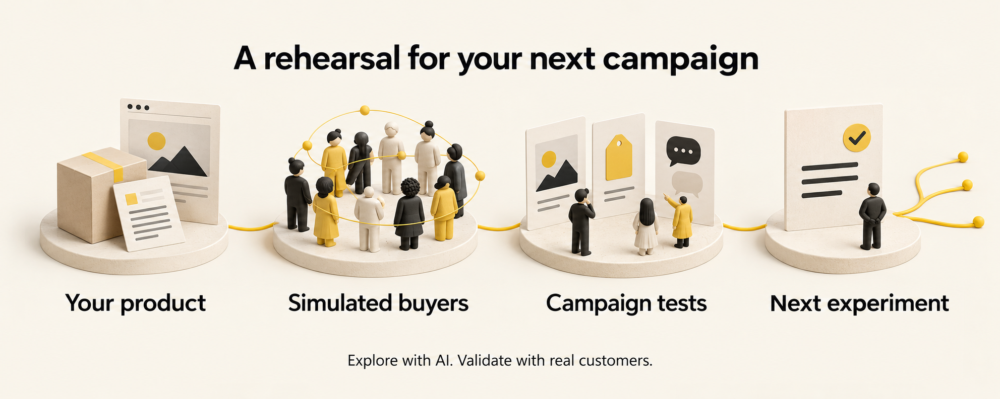
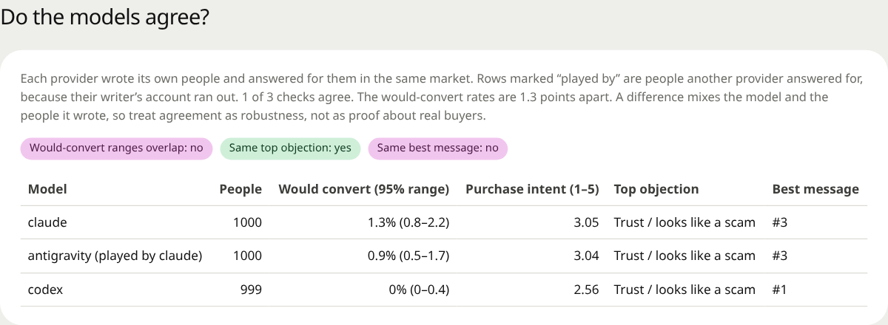
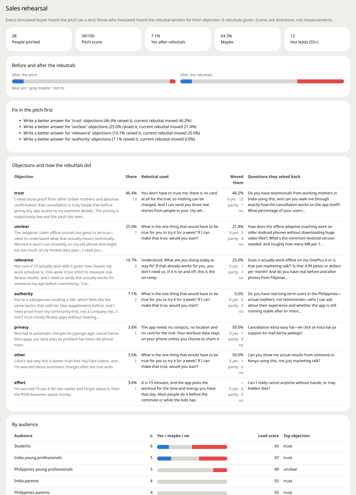
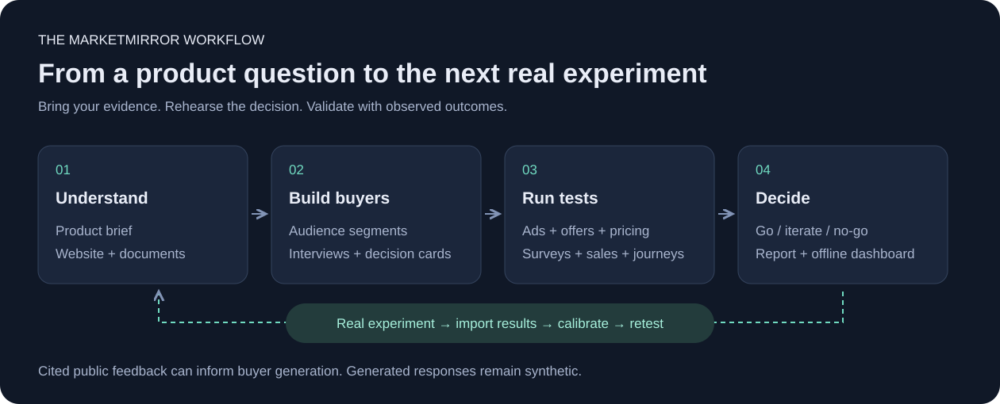
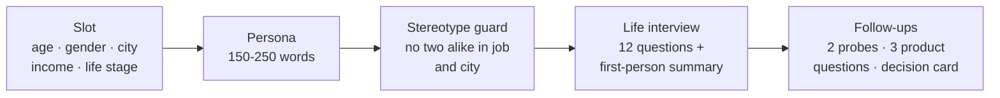
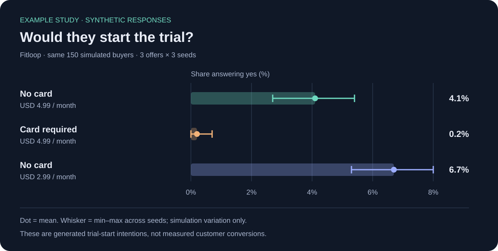
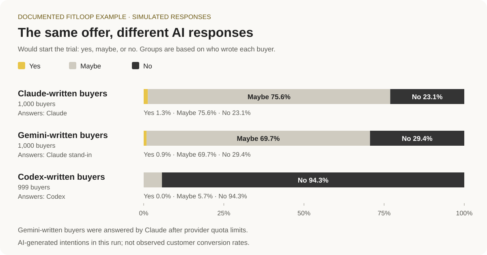
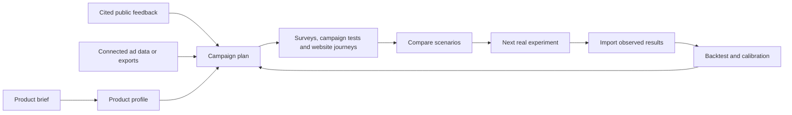

<div align="center">


# MarketMirror: AI Market Research & Marketing Simulation

**Try your ads, prices, and sales pitch with simulated buyers before spending on a real campaign.**

**Open source and built for AI agents.** Use it from Claude Code, Codex, Cursor, Gemini, or any MCP-compatible agent. Install the plugin, ask in plain words (*"test these three ads on young parents in India"*), and your agent builds the simulated buyers, runs the test, and shows you the dashboard. Self-hosted: it runs on your computer; only the model calls (to the provider you choose) and optional public research leave it.

[](https://github.com/DarkWorldCoder/market-mirror)
[](https://github.com/DarkWorldCoder/market-mirror/actions/workflows/tests.yml)
[](LICENSE)
[](plugin/README.md)

<a href="https://cdn.jsdelivr.net/gh/DarkWorldCoder/market-mirror@main/docs/video/marketmirror-launch.mp4"></a>

<sub>▶ <a href="https://cdn.jsdelivr.net/gh/DarkWorldCoder/market-mirror@main/docs/video/marketmirror-launch.mp4">Watch the 60-second launch film</a> (with captions) · <a href="https://cdn.jsdelivr.net/gh/DarkWorldCoder/market-mirror@main/docs/video/marketmirror-launch-vertical.mp4">vertical 9:16 cut</a> · made with HyperFrames from <a href="launch-video/">launch-video/</a></sub>

**[Open the live demo](https://darkworldcoder.github.io/market-mirror/demo/)**: the full dashboard from a 2,999-buyer simulated run, in your browser, no install. (Fitloop is an invented app; every number is simulated.)

If MarketMirror saves you one bad launch, a ⭐ helps other people find it.

[Meet the buyers](#meet-the-simulated-buyers) · [What you can test](#what-you-can-test) · [Screenshots](#the-dashboard) · [How it works](#the-process-at-a-glance) · [Example results](#example-results-simulated-market-studies) · [Get started](#quick-start) · [Documentation](#documentation)

</div>

## What is MarketMirror?

MarketMirror gives you a practice audience for your next marketing decision. Describe your product and the people you want to reach. It creates AI-generated people who can react to your ads, compare prices, ask questions, raise concerns, and respond to a sales pitch.

You get a report explaining what interested them, what put them off, what to change, and what to test with real customers next. You can also watch the simulation and explore the results in a dashboard.

For example: you are launching a fitness app. Should the ad lead with “15 minutes a day” or “less than one gym visit”? Should the free trial ask for a payment card? MarketMirror lets you rehearse those choices before a live campaign.

**The buyers are simulated.** Their responses are generated by AI, so use them to develop and compare ideas. Confirm promising findings with real customers and small live experiments.

## Who is it for?

| If you are… | Use MarketMirror to… |
|---|---|
| **A founder or small business owner** | Explore how different people might understand your product, price, or launch offer. |
| **A marketer or agency** | Compare ads, headlines, emails, and audiences before choosing a live test. |
| **A sales team** | Practice a pitch, discover likely concerns, and try clearer answers. |
| **A product or research team** | Explore buying decisions and website journeys, then plan customer research. |
| **A developer or AI agent builder** | Run the same workflows through commands, an API, a Python library, or connected AI assistants. |

## Meet the simulated buyers

A simulated buyer is an AI-generated character representing someone in your intended audience. The character has a background and practical reasons for accepting, questioning, or rejecting an offer.

You choose the groups you want to explore—for example, students, working parents, and young professionals in selected countries. MarketMirror creates different people within those groups and can ask them about their lives before showing them your marketing.

| What a buyer can have | Why it matters in a test |
|---|---|
| **A background** | Age, location, work, and life stage provide context for their response. |
| **A budget and priorities** | An offer may interest them but still compete with more urgent expenses. |
| **A phone and internet connection** | A heavy page or video may be inconvenient on their device or data plan. |
| **People they consult** | A partner, family member, or community may influence a purchase. |
| **Trust concerns** | Hidden fees, unclear claims, or a previous bad experience may make them hesitate. |
| **A buying decision card** | A summary records what could persuade them, what could stop them, and who else matters. |

**An illustrative buyer:** a busy parent who wants short home workouts, uses a budget phone, and worries about surprise charges. They might like a low monthly price but reject a “free” trial that immediately asks for a payment card. Another buyer may care more about workout quality than price. These are invented examples, not findings from real customers.

In tests within the same run, buyers can remember earlier experiences. Someone who disliked an ad can carry that reaction into a later survey or pitch. Separate comparison scenarios keep their own histories.

Detailed characters help you explore different viewpoints. They do not make the generated answers representative of a real population.

<a id="key-features"></a>

## What you can test

| Your question | What MarketMirror does | What you can learn from the simulation |
|---|---|---|
| **Which ad gets attention?** | Places your ads among ordinary posts in simulated Facebook, Instagram, Reddit, TikTok, LinkedIn, or X feeds. | Which ads buyers stop at, ignore, click, comment on, or hide. |
| **Which headline or message is clearer?** | Shows different versions to different buyers and asks for their reactions. | Which wording draws interest and which creates confusion. |
| **Does the price or offer feel right?** | Asks price questions and compares offers or pricing tiers. | Where price becomes a concern and which terms need explaining. |
| **What might happen around a launch?** | Lets buyers post, reply, and react in a simulated social conversation with scheduled brand posts and events. | Questions, objections, and themes that emerge in the discussion. |
| **Will an email interest them?** | Tests subject lines, email content, or a sequence in simulated inboxes. | Generated opening, reading, and response choices. No emails are sent. |
| **How does our sales pitch land?** | Presents the pitch, collects concerns, tries your answers, and asks again. | Which concerns persist and whether your response helps or makes things worse. |
| **Where does our website lose people?** | Sends simulated visitors through a real website and records their actions. | Where they hesitate, leave, or complete a checked task such as adding to cart. |
| **Which audience should we investigate first?** | Compares responses across the groups and countries you selected. | Differences worth following up with real customer research. |
| **What should we test next?** | Uses the run and, when supplied, real campaign exports to suggest follow-up experiments. | A practical starting point for the next live test. |
| **Do the simulations match our results?** | Compares paired simulated and observed outcomes. | How well the simulation held up on those experiments and where it needs adjustment. |

You can repeat a comparison to see whether its result changes between runs. You can also use different AI providers and inspect where they disagree. Both help reveal uncertainty within the simulation.

## The process at a glance



1. **Describe your product.** Provide a brief, documents, or a website: what you sell, who it helps, what it costs, and what supports your claims. You can also bring linked public feedback or campaign exports.
2. **Choose your audience.** Describe the groups and locations you want to explore. MarketMirror creates the simulated people. Review their profiles before continuing.
3. **Give them something to react to.** Add your ads, messages, prices, emails, pitch, or website task. Choose the tests that answer your question.
4. **Read the recommendation.** Explore the responses, concerns, comparisons, and suggested actions in the report and dashboard.
5. **Try a small real experiment.** Use actual customer responses or campaign outcomes to check what held up. Import those outcomes for comparison when you have suitable data.

The written report puts one recommendation at the top:

| Recommendation | How to use it |
|---|---|
| **Go** | Take the promising idea into a small real test. |
| **Iterate** | Change the weak parts and test again. |
| **No-go** | Reconsider this version before putting money behind it. |

These recommendations summarize simulation signals. A “go” does not guarantee sales.

## What you get

<picture>
  <source media="(prefers-color-scheme: dark)" srcset="docs/images/dashboard-dark.png" />
  
</picture>

*Actual product screenshot. Fitloop is an invented example app; all displayed buyer responses and performance figures are simulated. The illustrated banner and workflow above are conceptual artwork.*

- **A decision and next actions:** what to keep, what to change, and what to test with real people.
- **Buyer responses:** who was simulated, what they said, and their main concerns.
- **Comparisons:** differences between ads, messages, offers, audiences, and AI providers when those tests were run.
- **A shareable report:** a saved HTML dashboard that opens without a server, works offline, and includes tables behind its charts.
- **Downloadable results:** report and data exports in Markdown, JSON, CSV, and PDF.
- **A live view:** watch progress, buyer activity, and social posts as a run happens.

The full screenshot gallery and detailed explanations follow below.

## The dashboard

Each run produces one self-contained HTML dashboard: no server, no external requests, light and dark themes, and phone layouts. A sidebar groups its sections into overview, buyers, tests, evidence and the simulation itself; every chart has a table behind it, and the report exports to Markdown, JSON, CSV and PDF. In runs with more than 500 agents, the agents table lists the 500 most active and says so; everyone is still in the people cards and the CSV downloads. The screenshots below come from the 3,000-person Fitloop market (people written by Claude, Codex and Gemini), except the study page (the offer study) and the live control room (the 1,000-person run). `scripts/readme_screenshots.py` regenerates them from any run's `dashboard.html` with your installed Chrome.

<table>
<tr><td colspan="2"><b>Overview</b></td></tr>
<tr>
<td width="50%" valign="top"><br /><b>At a glance and the decision.</b> Headline numbers, the go / iterate / no-go call with the signals behind it, and a one-page brief with three actions, a budget plan and the next 30 days.</td>
<td width="50%" valign="top"><br /><b>Where they are.</b> A world map of the simulated people. Switch between people, would-convert, ad CTR, pitch yes and lead score per country; the table lists top cities and where people live.</td>
</tr>
<tr><td colspan="2"><b>Buyers</b></td></tr>
<tr>
<td width="50%" valign="top"><br /><b>What buyers said.</b> Purchase intent, interest, trust and word of mouth from free-text answers, mapped to 1–5 distributions and broken down by audience.</td>
<td width="50%" valign="top"><br /><b>Which audience to target.</b> Every segment, country, community, age band and gender side by side, with intent, trust, would-convert and the top objection.</td>
</tr>
<tr>
<td width="50%" valign="top"><br /><b>What stops people.</b> Objections ranked by share, each with synthetic buyer quotes and what would change that person's mind.</td>
<td width="50%" valign="top"><br /><b>Which message wins.</b> A randomized split test of your messages, plus the best message for each audience.</td>
</tr>
<tr><td colspan="2"><b>Tests</b></td></tr>
<tr>
<td width="50%" valign="top"><br /><b>Ads in realistic feeds.</b> Each ad shown in its platform's feed among organic posts: thumb-stop, CTR, what happened after the click, comments, and a spend projection.</td>
<td width="50%" valign="top"><br /><b>Social feed.</b> Every post of the simulated social rounds, with likes, replies and their sentiment, filters by round, audience and country, and activity per round.</td>
</tr>
<tr>
<td width="50%" valign="top"><br /><b>What people would pay.</b> Acceptable price range, sweet spot and the price-sensitivity curves, by segment.</td>
<td width="50%" valign="top"><br /><b>The playbook.</b> One card per audience: what to lead with, the objection to pre-empt, how to answer it, where to seed it, and a supporting synthetic quote.</td>
</tr>
<tr>
<td width="50%" valign="top"><br /><b>Do the models agree?</b> The same survey split by the provider behind each person, with 95% ranges and three checks. Here Codex's people were far more negative than Claude's, and Gemini's people, played by Claude after Gemini ran out of quota, answered like Claude's.</td>
<td width="50%" valign="top"><br /><b>The sales rehearsal.</b> Pitch score, yes/maybe/no before and after your rebuttals, and every objection with the rebuttal used, how many it moved and the questions people asked back.</td>
</tr>
<tr><td colspan="2" valign="top"><b>Marketing lab.</b> The marketing lab (buying committee, creative optimizer, battlecard, journey, pricing choice, competitor choice, landing teardown, roleplay, what-if, per-audience ads, search behaviour, real versus simulated concerns, word of mouth) shows every result with how many people were asked, answered and failed, and a 95% range.</td></tr>
<tr><td colspan="2"><b>Evidence</b></td></tr>
<tr>
<td width="50%" valign="top"><br /><b>Analyst panel.</b> Five analysts read the run independently; their consensus, the themes they agree on, and each one's recommendation.</td>
<td width="50%" valign="top"><br /><b>The simulated people.</b> Every person's life story from a short interview, phone and data plan, groups, what they did in the run, and a lead score. Filter by segment, country, verdict and lead score.</td>
</tr>
<tr>
<td width="50%" valign="top"><br /><b>The report.</b> A plain-language report with contents, the decision up front, who was simulated, results, objections, pricing, sales notes, an action plan and its limits. Exports to Markdown, JSON, CSV and PDF.</td>
<td width="50%" valign="top"><br /><b>Studies.</b> Several scenarios on the same people, each with several seeds: the winner, the side-by-side table, what changed and whether it is outside the seed spread.</td>
</tr>
<tr><td colspan="2"><b>Live</b></td></tr>
<tr>
<td colspan="2" valign="top"><br /><b>Live control room.</b> Watch a run as it happens at <code>/live</code>: each stage, every simulated person lighting up as they act and taking their answer's colour, what they post and comment, and the progress log.</td>
</tr>
</table>

Fitloop, its audiences and its pilot figures are invented; every number in these screenshots is simulated, not observed campaign performance. Report generation checks numbers against the run's fact sheet and falls back to a data-only report if the model fails. Those checks establish consistency with saved outputs, not real-world accuracy.

## How it works



| Stage | Input → output |
|---|---|
| **Understand** | Product brief, documents, or website → product profile and knowledge graph |
| **Build** | Audience segments and public feedback → simulated buyers with interviews and decision cards |
| **Test** | Ads, messages, prices, posts, or pitches → reactions, objections, and comparisons |
| **Decide** | Saved simulation outputs → recommendation, report, and dashboard |
| **Validate** | Observed campaign or survey outcomes → backtests, calibration, and the next experiment |

One command, `market-test`, runs the configured pipeline stages from a single config file. Individual tests can also run on their own. Everything a step produces is saved in the run folder, so a stopped run resumes where it stopped.

### 1. Understand the product

MarketMirror reads your brief, documents or website and writes a **product profile**: who it is for, the offer, the positioning, the proof, the competitors, and what is still unknown. Every later prompt reads this profile, so the simulated people react to your actual product rather than a vague idea of it.

Your documents also become a small **knowledge graph** (stored in local SQLite, searched with local embeddings, no extra service). Organisations and public figures in it can join the simulation as accounts that post.

Optionally, `research` collects what real people already say: Hacker News threads, country-specific App Store reviews, Reddit results and pages you supply, each with its link. Those quotes are shown to the people who write the simulated buyers, so the market starts from real wording.

### 2. Build the market

You describe the audiences in a small spec: "Students in India, 18-24, 500 people; parents in the Philippines, 30-45, 400 people", plus countries, cities and communities such as a WhatsApp running group or a subreddit. Then, for every person:



- **Slots** spread each audience evenly over ages, genders, cities (big and small), incomes and life stages, so you never get 500 copies of the same 24-year-old.
- **The stereotype guard** makes sure no two people in an audience share both a job and a city (it moves one to another city or varies the role, in code, with no model call) and flags any audience whose people came out too alike.
- **The life interview** asks what a researcher would: *Where did you grow up? How is money this month, and what do you cut first? What phone do you use, and what is your data plan like? Tell me about a time you got scammed. Who do you ask before spending real money? What annoys you most in ads?* The answers become a first-person summary in the person's own voice and language.
- **The decision card** is how this person buys: who they ask, how fast they decide, what triggers a yes, what stops them, their dealbreakers, the trust cues they look for, their monthly spare money, and where what they *say* differs from what they *do*.
- **Communities** give people somewhere to talk: each person joins a few of the groups you named, and they follow each other there.

One person from the 3,000-person run, exactly as the model wrote him (abridged):

| | |
|---|---|
| **Who** | Yash Malhotra, 42, Pune. Owner-driver of an app cab; runs a mobile-accessories stall at weekends. Lower-middle income, Realme 9 Pro, Jio prepaid ₹349 (2 GB a day). Member of *Working Moms & Dads India*. |
| **In his words** | *"Mi Yash Malhotra, 42, Pune madhe cab chalvto ani weekend la mobile accessories stall lavto… crypto course madhe ₹6,000 gelele mhanun reviews bghto ani bayko aai la vicharto."* (He lost ₹6,000 to a crypto course, so he reads reviews and asks his wife and mother.) |
| **Asks before buying** | Pooja (his wife), his mother, and Santosh at the stall |
| **Says yes to** | free trial, cheap price, family plan, a Hindi coach |
| **Walks away from** | over-promising ads, long unskippable ads, a card needed upfront; hidden charges |
| **Trusts** | reviews with 4+ stars, clear prices, family opinion |
| **Says vs does** | Says he would do 15 minutes during waiting time, but his shifts run long and he is tired, so he likely will not follow through. |

The people keep a memory for the whole run: someone who hid your ad or ignored your email carries that into the survey and the pitch. With several model providers, each provider writes its own share of the people and plays them from start to finish ([mixed markets](#several-models-in-one-market)).

### 3. Put them in the world

**Ads in realistic feeds (the feed test).** Each person scrolls a feed for each platform you test (Facebook, Instagram, Reddit, TikTok, LinkedIn, X): a handful of local organic posts with one of your ads placed where that platform puts its sponsored posts. When you test several ads, each person sees exactly one, assigned at random, so the comparison is a split test. For every post they report what they did: scrolled past, stopped and for how long, watched, reacted, commented, shared, saved, clicked or hid it, plus a one-line thought. Platform playbooks hold typical base rates (most people scroll past most ads), which keeps simulated people from being unrealistically positive. You get ads-manager numbers per ad and per audience (thumb-stop rate, CTR, what happened after the click), and with `--seeds 3` a range instead of one number.

**Social rounds.** The people then live on Reddit- and X-like platforms for a few rounds, powered by the [OASIS](https://github.com/camel-ai/oasis) engine with its recommendation feed. Your brand posts and your launch calendar (a price drop on day 3, an influencer post on day 5) arrive in the round you schedule them, and you can push live news into a running simulation ("a competitor just cut its price"). People post, reply, like, follow and argue in their own voices. The dashboard's **Social feed** shows every post by round, audience and country, with the replies to your brand posts and their sentiment.

### 4. Ask them

**The survey.** Everyone answers in their own words: would they try it, how interested are they, do they trust it, would they recommend it. Free text is turned into 1-5 rating distributions with **semantic similarity rating** ([SSR](https://arxiv.org/abs/2510.08338)): each answer is compared with five anchor statements using local embeddings, with no extra model calls. Asked for a number directly, language models give narrow, unrealistic rating distributions; rating their own words gives distributions much closer to real survey panels, as the SSR paper reports. The survey can also:

- split-test your messages, with each person randomly shown one;
- ask four price questions and draw the acceptable price range and sweet spot ([Van Westendorp](https://en.wikipedia.org/wiki/Van_Westendorp%27s_Price_Sensitivity_Meter));
- re-ask a sample "a simulated week later" and report how many gave the same verdict (test-retest);
- stop early once every audience's answer shares are within a margin you set.

**The sales rehearsal.** Your pitch goes to every buyer. They answer with their objection, your rebuttals answer back, and they decide again. You get the objections ranked, which rebuttals worked, and a lead score per person ("who to call first").

**The analyst panel.** Five analysts read the whole run independently and each recommends go, iterate or no-go. Their agreement is a check on the report, not a vote that decides it.

### 5. Decide

The **decision card** puts go, iterate or no-go at the top, with the signals behind it: the survey's purchase intent (go needs a mean of 3.75 on the 1-5 scale, iterate 3.1), the feed test's best ad, the analysts, the top objection. The **report** explains it in plain language: who was simulated, what they said, what stopped them, what to change, an action plan and the limits. Every number in it is checked against the run's fact sheet; if the writing model fails, a data-only report is produced instead.

It all lands in **one HTML dashboard** that opens without a server and works offline, in light and dark, on a phone. Every chart has a table behind it, and the report downloads as Markdown, JSON, CSV or PDF. A **live control room** shows a run while it happens: each stage, every person lighting up as they act, and what they post. [See the dashboard](#the-dashboard).

### 6. Check against reality

Simulated numbers mean little until they are compared with real ones. Import your real ad results or survey answers and MarketMirror:

- **backtests** its predictions against your past ads;
- **calibrates** the simulated survey against real answers: overlap, per-audience trust, and a corrected conversion rate;
- **forecasts** clicks or sign-ups for a budget, using what it learned from those comparisons;
- suggests **the next tests** from your real ad export and the run.

That loop, from simulation to a small real test and back, is the point: the simulation narrows down what to test; reality decides.

## Use cases

Each recipe starts from a prepared simulation (`./mm cli quickstart`, then `market-test` with `"approve_spend": true`). Ask your agent in plain words, or run the command yourself. Results land in the run folder and in the dashboard section named in the last column.

Start with the decision you need to make:

| Question | Test | Inspect |
|---|---|---|
| Which ad should we try first? | Feed test with repeated seeds | Attention, clicks, reactions, and audience differences |
| Does the offer feel trustworthy? | Survey and offer study | Intent, objections, and variation across seeds |
| What price should we test? | Price sensitivity or tier comparison | Acceptable range and simulated choices |
| Where does the website lose buyers? | Browser journey | Action trace, screenshots, and outcome checks |
| How should sales answer objections? | Pitch and rebuttal rehearsal | Before/after responses and objection themes |
| Does this match observed outcomes? | Holdout backtest and calibration | Errors, coverage, and validation limits |

| You want to know | Ask your agent | Or run | Look at |
|---|---|---|---|
| **Which ad to run** | "Test these 3 ads on our buyers in realistic feeds, 3 seeds." | `./mm cli feedtest --simulation $SIM --creatives @creatives.json --seeds 3` | Feed test, At a glance |
| **Which message or name lands** | "Split-test these headlines; which one makes people want to try it?" | `./mm cli survey --simulation $SIM --messages @messages.txt --split` | Messages, Results |
| **What to charge, and which offer** | "Would people start a trial with a card required? What price feels fair?" | `./mm cli survey --simulation $SIM --offer "7-day trial, no card" --pricing USD` | Pricing, Objections |
| **Whether a change really wins** | "Compare no-card vs card-required vs a lower price on the same people, 3 seeds each." | `./mm cli study --spec study.json` | Study, Scenarios |
| **Which country and audience to start with** | "Where does this land best: India, the Philippines or Kenya?" | personas spec with segments and countries, then `market-test` | Where they are (map), Audiences |
| **How a launch plays out socially** | "Run our launch posts and day-3 announcement through a few social rounds." | `market_test.json` keys `posts`, `events`, `rounds` | Social feed, Activity |
| **How news changes the conversation** | "A competitor just cut its price; push that into the running simulation." | `./mm cli context --simulation $SIM --text "..."` | Social feed (next round) |
| **Whether the email gets opened** | "Test these subject lines and a 3-step sequence in their inboxes." | `./mm cli emailtest --simulation $SIM --emails @emails.json` | Email |
| **How a sales pitch is received** | "Pitch every buyer, answer their objections, and tell me who to call first." | `./mm cli pitch --simulation $SIM --script @pitch.md --rebuttals @rebuttals.md` | Sales rehearsal, lead scores |
| **Whether the website converts** | "Send 3 buyers to our product page and see if they add to cart." | `./mm cli website-test --simulation $SIM --url https://... --goal add_to_cart` | Website test report |
| **What real people already say** | "Find what people say about home workout apps in India, with links." | `./mm cli research --query "home workout app" --country in` | Voices, Report |
| **What to test next, from real ads** | "Read our ad export and suggest the next three tests." | `./mm cli ideas --ads export.csv --run-dir mirofish_runs/x --brand Acme` | Test ideas |
| **What results to expect** | "Forecast sign-ups for USD 500 of spend, calibrated on our past campaigns." | `./mm cli predict --run-dir mirofish_runs/x --brand Acme --spend 500` | Predictions |
| **Whether the simulation matches reality** | "Compare the simulated survey with our real answers." | `./mm cli calibrate --run-dir mirofish_runs/x --real answers.csv` | Evidence, calibration verdict |
| **Why someone said no** | "Ask person 12 why they would not start the trial." | `./mm cli interview --simulation $SIM --agent 12 --prompt "..."` | (answer printed) |
| **Who blocks the deal and who signs** | "Run a buying committee on 12 households or companies." | `./mm cli gtm committee --simulation $SIM` | Marketing lab |
| **How to make an ad better** | "Rewrite this ad three times and re-test each version on the same people." | `./mm cli gtm creative --simulation $SIM --creative @ad.json --generations 3` | Marketing lab |
| **How to answer objections** | "Build a battlecard from their real objections and test the answers." | `./mm cli gtm battlecard --simulation $SIM` | Marketing lab |
| **Which tier people pick** | "Basic, Plus or Family at these prices: what share picks each?" | `./mm cli gtm pricing --simulation $SIM --tiers @tiers.json` | Marketing lab |
| **What happens if a competitor moves** | "Would they switch if X cuts its price by 30%?" | `./mm cli gtm competitors --simulation $SIM --competitors X Y --move "X cuts its price by 30%"` | Competitors |
| **Whether the landing page holds attention** | "Tear down our landing page with 20 buyers." | `./mm cli gtm teardown --simulation $SIM --url https://...` | Landing and sales lab |
| **Whether different models agree** | "Run the same market on Claude, Codex and Gemini people together." | `LLM_POOL` in the backend's settings (see [Several models in one market](#several-models-in-one-market)) | Do the models agree? |
| **What someone thought but did not say** | "Show me what people thought while they scrolled." | `./mm cli gtm thoughts --simulation $SIM` | Agent thoughts |
| **Where a theme shows up in the run** | "Find everything people said about price in Kenya." | `./mm cli search --run-dir mirofish_runs/x -q "price Kenya"` | (results printed) |
| **What is happening right now** | "Show me the run live." | `./mm live --run-dir mirofish_runs/x`, then open `/live` | Live control room |

Simulated people remember what happened to them across tests in the same run: someone who hid your ad or unsubscribed from the email carries that into the survey and the pitch. Each study cell keeps its own memory, so scenarios never leak into each other. Set `"memory_scope": "off"` in a config to test every step on fresh people.

Feed-test previews cover Facebook, Instagram, Reddit, TikTok, LinkedIn, and X. Optional social rounds use the MiroFish/OASIS Twitter and Reddit environments. Search, organic, referral, and sales test families adapt the existing survey, inbox, and pitch engines; they do not reproduce those channels' production systems.

<a id="real-results"></a>

## Example results: simulated market studies

These are outputs from documented local runs for **Fitloop, an invented fitness app**. They demonstrate the workflow and its limitations. They are not observed customer conversion rates or proof of predictive accuracy.

### At a glance

| Example | Scope | What it surfaced |
|---|---|---|
| **2,999-buyer mixed market** | Claude-, Codex-, and Gemini-written buyers across six audiences | Trust objections and substantial differences between answering models |
| **150-buyer offer study** | Three offers × three seeds on the same synthetic cohort | The card requirement reduced simulated willingness to start in every seed |
| **1,008-buyer launch test** | Feed test, social rounds, survey, and report | A conflict between the ad's no-card promise and the landing page's card requirement |



| Trial offer | Mean simulated “would start” | Min–max across 3 seeds |
|---|---:|---:|
| No card · USD 4.99 | 4.1% | 2.7–5.4% |
| Card required · USD 4.99 | 0.2% | 0.0–0.7% |
| No card · USD 2.99 | 6.7% | 5.3–8.0% |

Seed ranges describe simulation variation. The next step is a small randomized real experiment; the price cut did not establish a predictive win.

### The 3,000-person mixed market

One Fitloop market of 3,000 requested people, a third each written and interviewed by Claude Sonnet, Codex (gpt-6-luna) and Gemini 3.8 Flash (`gemini-3.8-flash-low`). Six audiences in India, the Philippines and Kenya, and five communities: Bengaluru Fitness Buddies (WhatsApp), Working Moms & Dads India (Facebook), Fit Pinoy Community (Facebook), Nairobi Runners & Gym Rats (WhatsApp) and r/budgetfitness; each person joins at most 2. The offer as advertised: a 7-day free trial with no card, then USD 4.99 a month. As in the 1,000-person run, the brief and the landing page still ask for a card at sign-up, and the test is meant to catch that.

**Decision: iterate** (medium confidence). The survey alone says no-go (purchase intent 2.88 of 5, 0.7% would start the trial, n = 2,999), the feed test says iterate (best ad `fb_parents`, expected CTR 1.02%), and 5 of 5 simulated analysts say iterate. Fix first: trust ("looks like a scam"), doubt that it is really free, and an unclear product.

| What was measured | Result |
|---|---|
| Would start the trial | 0.7% yes, 50.4% maybe, 48.9% no (2,999 of 2,999 answered) |
| Purchase intent from free-text answers (1-5) | 2.88 ± 1.14; interest 3.22 |
| Top objection | Trust / "looks like a scam": 59.6%; price 20.4%; unclear what it is 9.1% |
| By audience, would start | Philippines young professionals 1.7%, Philippines parents 0.9%, India parents 0.9%, India young professionals 0.6%, students 0.3%, Kenya young professionals 0.0% |
| Best survey message | "A month of Fitloop costs less than one gym visit" (about 1% yes, like the others) |
| Acceptable price range | USD 1.50-5.50, sweet spot about USD 2.20 |
| Test-retest (30 people, a simulated week later) | 76.7% gave the same verdict; 93.3% rated interest within 2 points |
| Sales pitch (2,997 of 2,999 answered both turns) | Before the rebuttal 1.1% yes, 64.0% maybe, 34.8% no; after it 1.1% yes, 44.6% maybe, 54.2% no. The trust rebuttal moved 44.9% of those who raised trust, the price rebuttal 8.9% |
| Social rounds (4 Reddit rounds) | 3,565 actions: 1,375 comment likes, 1,259 chose to do nothing, 770 comments, 135 post likes, 18 dislikes, 7 posts |
| Analyst panel | 5 of 5 iterate (3 played by Claude, 2 by Codex). Themes: no local payment (UPI), a USD price against free YouTube, trust needs proof, a card wall kills the trial, data cost on cheap phones |

The feed test, five ads across 5,140 person-platform sessions:

| Ad | Platform | Impressions | Thumb-stop | CTR | Expected CTR |
|---|---|---:|---:|---:|---:|
| `fb_parents` | Facebook | 858 | 17.9% | 2.2% | 1.02% |
| `ig_commute` | Instagram | 749 | 21.5% | 2.3% | 1.02% |
| `ig_price` | Instagram | 750 | 19.9% | 1.9% | 0.91% |
| `tt_challenge` | TikTok | 2,141 | 18.3% | 0.8% | 1.42% |
| `rd_honest` | Reddit | 642 | 15.3% | 0.5% | 0.41% |

The pitch made things worse, not better: after hearing the rebuttals, about a fifth of the people moved from "maybe" to "no" (pitch score 23 of 100). The report's fix: rewrite the trust and price rebuttals to show the exact charge after day 7, the cancel steps and the local price instead of arguing, which matches the analysts' themes.

**The models did not agree, and the answering model mattered most.** Split by the provider that wrote each person:

| People written by | Played in rounds, survey and pitch by | Would start: yes / maybe / no | Top objection |
|---|---|---|---|
| Claude (1,000) | Claude Sonnet 5.5 | 1.3% / 75.6% / 23.1% | trust, then price |
| Gemini (1,000) | Claude Sonnet 5.5 (stand-in) | 0.9% / 69.7% / 29.4% | trust, then price |
| Codex (999) | Codex | 0.0% / 5.7% / 94.3% | trust, then "unclear" |



Gemini's people, written by Gemini but played by Claude, answered like Claude's people, not like Codex's. So in this run the model that answers shapes the survey far more than the model that wrote the person, and Codex is much more negative than Claude. Read every rate above as a range between those two behaviours, not as one market's answer.

**How the run went.** The population took 2 h 57 min to prepare (with one restart), and the feed test 62 min through the three login gateways. The social rounds then ran into usage limits: four times Gemini's or Claude's login hit its limit during the rounds, and each hit started the four rounds over, usually after waiting hours for the reset. Then Gemini's login ran out of quota for about four days (Flash and Argon alike). So the rest of the run moved to an Anthropic API key: Claude Sonnet 5.5 played the Claude-written people and, as a stand-in (`MM_PROVIDER_STANDIN=antigravity=claude`), the Gemini-written ones; Codex kept playing its own people through its login. From there it ran without a pause: four rounds in 40 minutes, the survey of 2,999 with its retest in 23 minutes, the pitch to 2,999 people in 37 minutes, then the panel and the report. The API spend for that part is on the Anthropic console; MarketMirror did not meter the tokens inside the rounds, survey and pitch.

The population behind it:

| | Claude | Codex | Gemini | All |
|---|---:|---:|---:|---:|
| People written | 1,000 | 999 | 1,000 | 2,999 |
| Interviewed | 1,000 | 987 | 1,000 | 2,987 |
| With a decision card | 980 | 933 | 992 | 2,905 |

- One requested person was not written because their calls failed. They are counted, not filled in.
- The 12 Codex people whose interview failed are kept at depth `profile`. 82 interviewed people have no decision card.
- Audiences: Students 642, Philippines young professionals 536, India young professionals 534, India parents 429, Philippines parents 429 and Kenya young professionals 429, each split evenly across the three providers. By country: India 1,284, the Philippines 1,125 and Kenya 590.
- The stereotype guard changed 20 people and found no audience with too little variety.
- With 7 actors from the knowledge graph and the 5 community accounts, the simulation has 3,011 agents, each with a profile.
- The feed test made 1,289 model calls (Gemini 442, Codex 440, Claude 407) with 19.9M input and 0.94M output tokens, and lost no session.

### Which offer should Fitloop launch with?

A study ran three offers on the same 150 simulated buyers, three seeds each (9 cells, about 10 minutes per cell through the local Claude Code gateway). Each number is the mean across seeds, with the lowest and highest seed in brackets; the brackets show simulation variation only.

| Measure | No card, USD 4.99 | Card required, USD 4.99 | No card, USD 2.99 |
|---|---:|---:|---:|
| Purchase intent (1–5) | 3.51 (3.46–3.60) | 3.01 (2.99–3.04) | 3.60 (3.59–3.60) |
| Would start the trial (%) | 4.1 (2.7–5.4) | 0.2 (0.0–0.7) | 6.7 (5.3–8.0) |
| Would click (%) | 7.7 (3.3–16.5) | 10.9 (8.0–12.7) | 23.5 (21.3–25.3) |
| Trust (0–10) | 3.6 (3.4–4.0) | 3.4 (3.3–3.4) | 4.1 (4.1–4.1) |
| "Looks like a scam" as top objection (%) | 54.6 (47.5–59.7) | 88.2 (86.7–90.7) | 60.5 (58.0–62.7) |
| Decision across seeds | iterate in 2 of 3 | no-go in 3 of 3 | iterate in 2 of 3 |

**What the study concluded.** Requiring a card was a clear loss in every seed: intent fell by 0.5, would-start fell by 3.9 points, "maybe" answers fell by 44.8 points, and scam worry rose by 33.6 points, all outside the seed spread. Dropping the price to USD 2.99 lifted would-click (+15.8 points) and trust (+0.47) beyond the spread, but its intent gain (+0.09) stayed inside it, so the price cut is not a clear winner even in simulation. It came out best in 2 of 3 seeds, and the study's summary marks its result as not supporting a predictive claim. The recommendation: keep the trial card-free, work on trust (proof, a named company, a clear "no card needed" line), and run a small randomized real test of USD 2.99 against USD 4.99. The full write-up is generated as `study_report.md` next to `study.html` in the study folder.


### The 1,000-person run: what 1,008 simulated buyers said


Offer: 7-day free trial without a card, then USD 4.99 a month, shown to young professionals, parents and students in India, the Philippines and Kenya.

| Measure | Result |
|---|---|
| Answered the survey | 1,001 of 1,008 |
| Would start the trial | 1.1% yes, 74.8% maybe, 24.1% no |
| Purchase intent from free-text answers (1–5) | 3.07 ± 1.12 |
| Top objection | "Looks like a scam / trust": 70.3% |
| Most willing audience | Kenya young professionals: 2.8% yes, 8.3% would click |
| Least willing audience | Students: 0% yes (their answers were too similar to trust; flagged in the report) |
| By country, would start | Kenya 2.0%, India 0.9%, the Philippines 0.8% |
| Best survey message | "A month of Fitloop costs less than one gym visit": 1.5% yes vs 0.9% for the others |
| Acceptable price range | USD 1.80–7.99, sweet spot around USD 2.49 |
| Test–retest agreement (30 people, a simulated week later) | 86.7% gave the same verdict |
| Analyst panel | 5 of 5 analysts: iterate |

**What it concluded: iterate** (medium confidence). The signals differ: the survey alone points to no-go (n = 1,001), the feed test to iterate (best creative fb_parents, expected CTR 1.58%), and all five simulated analysts to iterate. The decision written at the end of the run, before the analyst panel was added, was no-go. The idea interests people (three in four said maybe), but trust blocks them. The report also caught a concrete flaw: the ad promises "no card", while the landing page form asks for a card number, expiry and CVV, and simulated people dropped off at that step. The next step it recommends is to remove the card step, add proof from real users in each country, and retest. These are simulated people; treat every rate as a direction until a real experiment confirms it.

Preparation, active simulation turns, surveys, email/feed reactions, pitches, and reports can all use model calls. Repeated seeds multiply work. Local gateways report upstream usage when available and label estimates; subscription use does not imply a measured monetary cost. Measure a small run before choosing a large cohort. First-time embedding setup may download model assets even when inference runs locally.

### Measured runs

These are local Fitloop measurements, not speed guarantees. Model, hardware, activity settings, concurrency, and provider limits affect runtime. Every rate in this section is simulated.

| Run | Simulated buyers | Scope | Measured wall time | Feed-test calls | Invoiced cost |
|---|---:|---|---:|---:|---|
| Fitloop launch | 28 | Marketing pipeline | 28m 12s | 75 | Unavailable |
| Fitloop | 150 | Marketing pipeline | 54m 50s | 262 | Unavailable |
| Fitloop mixed market check | 12 (4 each from Claude, Codex and Gemini) | Feed test, 2 social rounds (37 actions), survey, pitch, through the three login gateways | 17m 50s | 23 (Claude 8, Gemini 8, Codex 7) | Subscriptions (no invoice) |
| Fitloop large (social only) | 1,008 | Six Reddit social rounds only | 3m 42s | Not measured | Unavailable |
| Fitloop 1,000 | 1,008 | Full pipeline on Sonnet via the Claude Code gateway: feed test, 4 Reddit rounds, survey of 1,008 + retest of 30, 5 analysts, report | about 52m of active work | 434 | Subscription (no invoice) |

The 1,000-person run's active time breaks down as feed test 10m 17s (434 calls, 1,296,106 input and 375,768 output tokens), four social rounds 18m 28s (1,159 actions), survey and retest 20m 29s, report 1m 26s; the analyst panel failed during that run (all five analysts; fixed afterwards) and was run again later. Its wall-clock time was much longer: the Claude Code session limit paused it for 4h 12m mid-survey, it was resumed by hand the next morning, and the four social rounds were run again, so the active times above count only the final pass. API providers apply their own rate limits and quotas.

Preparing the people is measured separately, through the three login gateways. "Writing the people" is the persona planner alone (personas, interviews and follow-ups); "upload to ready" adds the knowledge graph, agent profiles and simulation config. At full depth the decision card comes from the follow-up call, so that column is also the number followed up.

| Run | Depth | People (Claude / Codex / Gemini) | Interviewed | Decision card | Not written | Writing the people | Upload to ready |
|---|---|---|---:|---:|---:|---:|---:|
| Full-depth speed check | full | 60 (20 / 20 / 20) | 60 | 57 | 0 | 6m 7s | 7m 16s |
| Fast population check | fast | 150 (45 / 55 / 50) | 24 | 150 | 0 | 7m 29s | 8m 51s |
| Fitloop 3,000 mixed market | full | 2,999 (1,000 / 999 / 1,000) | 2,987 | 2,905 | 1 | 2h 40m 11s, with a restart | 2h 57m 31s, with a restart |

The 60- and 3,000-person runs used Sonnet, gpt-6-luna and gemini-3.8-flash-low. The 150-person run used Sonnet, Codex's default model and gemini-3.8-flash-medium; its 24 interviews are 4 per audience. It predates the even per-audience split (each audience was split 20 + 5 between two providers, hence 45 / 55 / 50); current runs split every audience evenly across all providers.

The 3,000-person times are not a clean single pass. At 14:34, after 1,865 of 3,000 people, the backend was restarted to apply a lane fix (hung calls had cut the Gemini lane from 10 to 2; now only a rate limit halves a lane). The new prepare task replayed 1,043 finished answers from the population cache and wrote the rest; that second part alone took 1h 54m 39s. After the people were written, the 3,011 agent profiles took about 7.5 minutes and the simulation config about 9.5 minutes.

## Quick start

Requires Git, Bash, Python 3, and [uv](https://docs.astral.sh/uv/). The installer provisions the Python 3.12 environment. Use Linux, macOS, or WSL; native Windows has not been validated.

```bash
git clone https://github.com/DarkWorldCoder/market-mirror.git
cd market-mirror
bash install.sh
./mm configure
```

Choose your model provider, then start the backend and create your first scenario:

```bash
./mm provider check
./mm start
./mm cli quickstart --out scenarios/acme
```

The wizard asks about your product, buyers, channels, budget, and test size. It writes editable inputs, prepares the simulated people, and stops for review before running the remaining tests. **Preparation itself uses model calls.** Start with a small cohort. `provider check` discovers models without running inference; it does not test model quality or tool support.

Inspect the generated files and profiles. To continue, retain the returned `simulation_id`, set `"approve_spend": true` in `scenarios/acme/market_test.json`, and run:

```bash
./mm cli market-test scenarios/acme/market_test.json
./mm live --run-dir mirofish_runs/acme
```

The live viewer runs at [127.0.0.1:5050](http://127.0.0.1:5050), and its control room at [127.0.0.1:5050/live](http://127.0.0.1:5050/live) shows every stage, every simulated person lighting up as they act, what they post, and the progress log, updated every two seconds. Use the actual run directory printed by the pipeline if its name differs. The saved `dashboard.html` also opens directly without a server. To generate templates without preparing people, use `./mm cli quickstart --no-run`.

<details>
<summary>Resuming interrupted runs and choosing the right start command</summary>

If a `market-test` run stops (a crash, a restart, a closed terminal), first make sure the earlier `market-test` process has exited and `./mm cli status --simulation <sid>` shows no rounds running (wait for them, or stop them with `./mm cli stop`), then run the same command again, with the same `MIROFISH_URL` for a backend on another port. It resumes from the run folder's `run_manifest.json`, and a simulation that stopped before its people were ready is prepared again; people already written come from the cache. With `"resume_steps": true` in the config it also reuses a usable saved feed test and survey and a live social environment. The wait for preparation grows with the market (at least an hour, or about 6 s per person), and backend tasks are followed for up to six hours.

`./mm start` starts the backend; `./mm cli start --simulation …` starts social simulation rounds. All examples below use the repository's `./mm` helper—no global command or alias is required.

</details>

### Test your product URL

Install the optional browser support, then use a prepared simulation's ID:

```bash
uv sync --project backend --extra browser --python 3.12
backend/.venv/bin/python -m playwright install chromium
./mm cli website-test --simulation "$SIMULATION_ID" \
  --url https://your-product.example/products/shoes --goal add_to_cart \
  --task "Evaluate these shoes and decide whether to add a suitable pair to your cart." \
  --limit 3 --steps 12
```

Restart the backend after installing the browser extra. Replace the URL with your site. Browser control supports search and keyboard actions, product options, hover menus, same-site tabs and frames, open shadow DOM, and bounded recovery when the page changes. Add `--record-video` for a recording or `--headed` to watch on a desktop with a graphical session. Agents may interact with the actual cart; signup submission requires explicitly supplied test data and opt-in. No orders or payments are supported. Named DOM checks verify outcomes independently of what an agent claims. Without them, completion stays unverified. See [real website testing](docs/WEBSITE_TESTING.md) for outcome checks, signup setup, browser limits, and the evidence report.

Browser runs use compact model observations while retaining full local evidence. Set call, input-token, and elapsed-time limits; repeated actions on unchanged pages are detected separately from buyer departures. Reports show available cache usage, model time, and cost basis. See [browser context and run limits](docs/WEBSITE_TESTING.md#control-context-usage-and-run-limits).

## Choose your model

| Provider | Setup | Authorization |
|---|---|---|
| **Local Codex** | `./mm gateway start codex` | Existing local Codex login |
| **Local Claude Code** | `./mm gateway start claude` | Existing local Claude Code login |
| **ChatGPT sign-in** | `./mm gateway login`, then `./mm gateway start siwc` | Eligible account; scope and model access checked during setup |
| **Local Antigravity (Gemini models)** | `./mm gateway start antigravity --model gemini-3.8-flash-medium` | Existing local Antigravity login; `agy models` lists the models it offers |
| **Local Gemini CLI** | `./mm gateway start gemini` | Existing local Gemini CLI login |
| **Every installed login behind one gateway** | `./mm gateway start multi` | The login CLIs that are installed and signed in (`LLM_GATEWAY_POOL` lists which); calls are spread across them, so use `LLM_POOL` (below) to keep one provider per person |
| **Ollama / LM Studio** | Choose the provider in `./mm configure` | A locally installed, tool-capable model |
| **Claude / OpenAI / Google Gemini API** | Choose the provider in `./mm configure` | Provider API key (`ANTHROPIC_API_KEY`, `OPENAI_API_KEY`, `GEMINI_API_KEY`) and available model access |
| **Other API providers**: DeepSeek, Kimi (Moonshot AI), Mistral, xAI (Grok), Groq, Together AI, Fireworks AI, OpenRouter, Qwen (Alibaba Model Studio), Z.ai (GLM), Cerebras, MiniMax | `./mm configure`, the settings page (`./mm cli setup`), or `.env`: `LLM_PROVIDER=deepseek` + `DEEPSEEK_API_KEY` (base URL and a default model are filled in; `<NAME>_BASE_URL` and `<NAME>_MODEL_NAME` override them; Qwen also needs `QWEN_BASE_URL`, which contains your workspace id) | That provider's API key (`MOONSHOT_API_KEY`, `XAI_API_KEY`, `ZAI_API_KEY`, `DASHSCOPE_API_KEY`, otherwise `<NAME>_API_KEY`) |
| **Other compatible servers** | Configure the endpoint and model, or the pool slot `custom` (`CUSTOM_BASE_URL`, `CUSTOM_API_KEY`, `CUSTOM_MODEL_NAME`) | Provider-dependent |

A login gateway uses the subscription you already have, with its usage limits. API providers bill usage separately and apply their own rate limits and quotas. Model choice, gateway settings, usage-limit pauses, prompt caching with a Claude API key, the settings page and API costs for 3,000 people are in [providers, mixed markets and large runs](docs/PROVIDERS_AND_SCALE.md).

The default knowledge graph uses local SQLite and local embeddings; no Zep account is required. Model downloads and public-source research require network access. Hosted providers and CLI gateways receive model prompts through the selected provider. Model usage remains subject to that account's limits and charges.

## Several models in one market

One market can be played by several providers at once, for example Claude, Codex and Gemini. Each provider writes an equal share of every audience, interviews its own people, plays them in the feeds and social rounds, and answers for them in the survey and pitch, so one model speaks for a person from start to finish. The dashboard then asks **"Do the models agree?"**: it splits the results by provider and checks whether their would-convert ranges overlap and whether they name the same top objection and best message. Agreement is a robustness check on the simulation, not evidence about real buyers.

```bash
LLM_POOL=claude_code:sonnet,codex:gpt-6-luna,antigravity:gemini-3.8-flash-low
LLM_POOL_STRICT=true          # rounds and tests stay on each person's own provider
```

Each provider gets its own lane of calls in flight, so a slow one never holds up a fast one, and a provider whose account runs out can move to an API key or be stood in for by another provider mid-run. The full setup (gateways on separate ports, tokens, lanes, depth settings for thousands of people) is in [providers, mixed markets and large runs](docs/PROVIDERS_AND_SCALE.md).

## Connect your agent

Use MarketMirror from Codex, Claude Code, Cursor, Gemini, or another client supporting its MCP transport. Install and configure the engine first using the quick start above.

### Codex plugin

From the repository root:

```bash
codex plugin marketplace add "$PWD"
codex plugin add market-mirror@market-mirror-local
```

### Claude Code plugin

```bash
claude plugin marketplace add "$PWD"
claude plugin install market-mirror@market-mirror
```

The plugin bundles the main workflow plus focused research, planning, testing, and evidence-review Agent Skills. They share one canonical source. Client plugin support and configuration locations vary; see the [plugin guide](plugin/README.md).

### Any compatible MCP client

Print configuration for your client without overwriting its settings:

```bash
./mm agent-config --client generic
# Also supports: codex, claude, cursor, gemini
```

The output contains an absolute server path and engine location. Copy the entry into your client's MCP configuration and restart the client. The stdio server can also be launched with `./mm mcp`.

For authenticated loopback HTTP MCP:

```bash
python3 plugin/skills/market-mirror/scripts/mcp_server.py \
  --http --port 5061 --token-file /absolute/path/to/private-token
```

Create a private token file containing a random bearer token of at least 24 characters. Connect to `http://127.0.0.1:5061/mcp` using that token. This transport is intended for local agents, not a hosted remote service.

Try this in your agent:

> Use MarketMirror to analyze our product and campaign performance. Bring in ad and analytics data from tools you have authorized access to, or use the exports I provide. Research cited customer feedback, survey a small simulated audience, and compare two ads or offers. Test our product URL with synthetic visitors, show the evidence and missing inputs, and recommend the next real experiment.

Core tools: `doctor`, `provider_setup`, `understand`, `ads_import`, `ideas`, `website_test`, `research`, `actuals_import`, `campaign_plan`, `run_test`, `study`, `job_status`, `holdout_backtest`, `predict`, and `results`. Long jobs return status, logs, and result paths. Poll `job_status` before treating a job as complete.

## Example workflow



After quickstart creates `scenarios/acme/`, replace its example content with your product material:

```bash
./mm cli understand --docs scenarios/acme/brief.md --name Acme \
  --out scenarios/acme/product_profile.json

./mm cli research --query "home workout app" --country in \
  --out scenarios/acme/research

./mm cli campaign-plan --profile scenarios/acme/product_profile.json \
  --research scenarios/acme/research/voices.json \
  --goal "trial signup" --budget 500 --currency USD \
  --channels search organic paid_social email sales referral \
  --out scenarios/acme/campaign_plan.json
```

The plan contains `test_specs`, cited evidence, assumptions, and unknowns. Channel budgets start as equal draft allocations. Review the claims and allocations, save a selected spec as `experiment.json`, and test it on a prepared simulation:

```bash
# Set this to the ID returned by your preparation step.
SIMULATION_ID=sim_replace_me
./mm cli test --simulation "$SIMULATION_ID" --spec @experiment.json
./mm cli study --spec study.json
```

`experiment.json` and `study.json` are your reviewed input files; [input examples](docs/INPUT_FORMATS.md) and `./mm cli study --help` describe their contracts. Study cells reuse completed work; rerun the same specification to resume. Each independent comparison should begin from the same initial state and matched scenario seeds.

Import actual outcomes when available. This example expects an export with `Day`, `Country`, `Views`, and `Clicks` columns:

```bash
./mm cli actuals-import exports/campaign.csv --source-type ads \
  --map date=Day market=Country impressions=Views clicks=Clicks \
  --out scenarios/acme/actuals.json

./mm cli holdout-backtest --pairs experiments_with_train_and_holdout.json \
  --out scenarios/acme/holdout_backtest.json
```

The importer retains source, date, market, and quality labels and returns row-level validation errors. Backtests require explicitly paired simulated and real outcomes with declared training/holdout splits; the imported export alone is not a ready-made holdout dataset.

<details>
<summary>Useful commands after preparing a simulation</summary>

```bash
./mm cli profiles --simulation "$SIMULATION_ID" --brief
./mm cli feedtest --simulation "$SIMULATION_ID" --creatives @creatives.json --seeds 3
./mm cli survey --simulation "$SIMULATION_ID" --offer "Acme trial" \
  --goal "start a trial" --messages @messages.txt --split --pricing USD
./mm cli emailtest --simulation "$SIMULATION_ID" --emails @emails.json
./mm cli pitch --simulation "$SIMULATION_ID" --script @pitch.md --rebuttals @rebuttals.md
./mm cli report --simulation "$SIMULATION_ID" --run-dir mirofish_runs/acme
```

If preparation saved a complete profile set but stopped before its configuration was ready, use `./mm cli prepare --simulation "$SIMULATION_ID" --resume-only`. It reuses saved profiles and refuses to regenerate incomplete sets.

Keep inputs under `scenarios/` and outputs under `mirofish_runs/`; both are gitignored. Use `./mm cli --help` for the full command list.

</details>

## What it adds to OASIS and MiroFish

MarketMirror is built on [MiroFish](https://github.com/666ghj/MiroFish), which runs on [OASIS](https://github.com/camel-ai/oasis). OASIS gives a realistic social platform (feeds, posts, follows and a recommendation system) where language-model agents act. MiroFish adds a knowledge graph and a prediction report on top. MarketMirror turns them into a market test that ends in a decision:

MarketMirror adds audience planning, marketing experiments, and decision reports to that foundation:

| Layer | Role in the workflow |
|---|---|
| **[OASIS](https://github.com/camel-ai/oasis)** | Social simulation environments with agent actions and recommendation feeds. |
| **[MiroFish](https://github.com/666ghj/MiroFish)** | The upstream application foundation for knowledge graphs and simulation reports. |
| **MarketMirror** | Segmented synthetic buyers, ad and offer tests, surveys, sales rehearsals, provider comparisons, offline reports, and calibration workflows. |

## Evidence and simulation limits

- **Generated interviews remain synthetic.** Detailed biographies and BDE profiles do not turn invented people into customer evidence.
- **Behavior controls are assumptions.** Attention, fatigue, social proof, and landing friction include hand-set priors that need validation for the intended market.
- **Seed variation measures simulation variation.** It is not a predictive confidence interval. Repeated agreement and synthetic test–retest consistency do not establish agreement with humans.
- **Backtests answer specific questions.** The existing no-persona comparator is the mean real outcome in the training set. Beating it alone does not establish general predictive reliability or replace a matched generic-reader LLM comparison.
- **Calibration depends on coverage and assumptions.** Uncalibrated predictions omit intervals and success probabilities. Validate absolute rates, rankings, and subgroup findings separately on untouched real experiments.

Read the [human-behavior research guide](docs/HUMAN_BEHAVIOR_RESEARCH.md) for the papers, inspected code gaps, and proposed memory/state architecture. It distinguishes implemented controls from future work and experimentally supported results.

## Frequently asked questions

### Are these real buyers or people I can contact?

They are AI-generated characters inside the simulation. Their names, stories, responses, and lead scores describe those characters. They are not a contact list of real prospects.

### Will MarketMirror run my ads or send emails?

It simulates ads, inbox reactions, and sales conversations. It does not publish ads, send outreach, or change your ad account.

### Can buyers use my actual website?

Yes, with optional browser support. Synthetic visitors can inspect real pages and attempt tasks such as finding a product or adding it to a cart. Reports include screenshots and action records. Explicit page checks are needed to verify task completion. Orders and payments are not supported; see [website testing](docs/WEBSITE_TESTING.md) for supported actions and signup requirements.

### Do I need to write code?

You can request tests in plain language through a connected AI assistant. Installing MarketMirror, choosing a model, and connecting that assistant require technical setup. The command-line tools are also available for direct use.

### Is it free?

MarketMirror's source code is available under [AGPL-3.0](LICENSE). Running it may consume paid AI usage, subscription allowances, or local computing resources. Audience size, interview depth, tests, and repeats affect the work required. [Measured runs](docs/TECHNICAL_GUIDE.md#measured-runs) give examples, not cost or speed guarantees.

### Can I bring real research and campaign data?

Yes. You can supply product documents, linked feedback, and campaign exports. MarketMirror can also collect supported public feedback with source links. Comparing simulations with actual outcomes requires suitable paired data; importing an ad export alone does not create a complete validation study.

### What do the technical terms mean?

| Term | Plain-language meaning |
|---|---|
| **Persona / synthetic buyer** | An AI-generated character representing a type of buyer. |
| **Audience segment** | A group you want to explore, such as students or working parents. |
| **Creative** | The image, video idea, or copy used in an ad. |
| **Split test / A/B test** | Showing different versions to different people to compare responses. Here those people are simulated. |
| **CTR** | Click-through rate: the share of ad views that produced a click. In a simulated test, both are generated events. |
| **Seed** | A random starting setting used to repeat a simulation under different draws. |
| **Backtest** | Comparing a simulation with known outcomes from past experiments. |
| **Calibration** | Adjusting the simulation's estimates using observed results. It still needs independent evaluation. |

## Other integrations

| Interface | Entry point |
|---|---|
| **REST API** | Backend at `http://127.0.0.1:5001`; [endpoint guide](docs/API.md) and [OpenAPI schema](docs/openapi.json) |
| **Python SDK** | `pip install -e sdk`, then `from marketmirror import MarketMirror`; [SDK examples](sdk/README.md) |
| **Docker** | Configure `.env`, then `docker compose up --build`; backend on 5001, viewer on 5050, both published on loopback |
| **Webhooks** | Set `MIROFISH_WEBHOOK_URL` to receive completion summaries from CLI pipelines, studies, and tests |

The Docker services mount uploads, scenarios, and run outputs from the host. The host's loopback login gateway is not directly reachable from those containers; use a provider reachable from the container or run the CLI gateway workflow on the host.

## Development

```bash
cd backend
uv sync --python 3.12
uv run --no-sync python -m pytest tests claude_cli/tests -q
```

Tests mock model calls and do not need a live model key. CI also checks generated API documentation. Backend services live in `backend/app/`, the CLI and report renderer in `backend/claude_cli/`, agent tools in `plugin/`, and the Python SDK in `sdk/`.

## Documentation

| You want to… | Read this |
|---|---|
| Install MarketMirror and connect an assistant | [Local installation and agent setup](docs/LOCAL_AGENTS.md) |
| Keep a separate copy of the detailed setup and reference | [Technical guide](docs/TECHNICAL_GUIDE.md) |
| Choose AI providers or run a larger audience | [Providers and scale](docs/PROVIDERS_AND_SCALE.md) |
| Prepare buyer specifications, ads, and test files | [Input formats](docs/INPUT_FORMATS.md) |
| Test an actual product website | [Website testing](docs/WEBSITE_TESTING.md) |
| Install the agent plugin | [Plugin guide](plugin/README.md) · [Codex setup](codex/README.md) |
| Build an integration | [REST API](docs/API.md) · [OpenAPI schema](docs/openapi.json) · [Python SDK](sdk/README.md) |
| Understand the research and proposed improvements | [Human-behavior research](docs/HUMAN_BEHAVIOR_RESEARCH.md) |
| Contribute or report a problem | [Contributing](CONTRIBUTING.md) · [Security](SECURITY.md) · [Changelog](CHANGELOG.md) |

## Support the project

If MarketMirror was useful, ⭐ star the repo so other people find it, and [tell us what you tested](https://github.com/DarkWorldCoder/market-mirror/issues). Every issue gets an answer.

## Credits and license

MarketMirror builds on [MiroFish](https://github.com/666ghj/MiroFish) and [OASIS](https://github.com/camel-ai/oasis), adding audience planning, marketing tests, and decision reports to their simulation foundation. It is released under [AGPL-3.0](LICENSE).

The dashboard embeds [Apache ECharts](https://echarts.apache.org); see [third-party notices](backend/claude_cli/vendor/README.md). The [original MiroFish README](docs/MIROFISH-UPSTREAM.md) is preserved. The banner and workflow illustrations were AI-generated; their [generation prompts](docs/brand/readme-image-prompts-v2.txt) are included.
