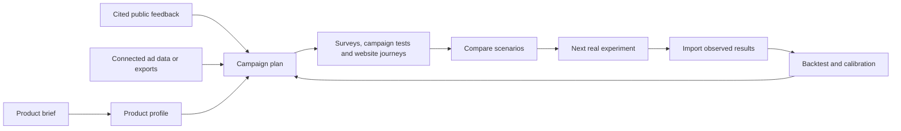

<div align="center">

<picture>
  <source media="(prefers-color-scheme: dark)" srcset="docs/brand/marketmirror-logo-dark.png" />
  
</picture>

# MarketMirror

**Your agent's marketing research and simulation lab.**

Analyze real ad performance your agent can access, research customer feedback, survey simulated buyers, and test campaigns, pricing, sales pitches, and real product journeys. Turn the findings into your next experiment.

Self-hosted · Open source · Local agents and MCP · Offline HTML reports

[Quick start](#quick-start) · [Connect your agent](#connect-your-agent) · [Example workflow](#example-workflow) · [Documentation](#documentation)


</div>

MarketMirror gives Codex, Claude Code, and compatible MCP agents a shared toolkit for marketing, sales, and product analysis. Bring a product brief or website, campaign results, and customer evidence. Build an audience, run simulated surveys and interviews, compare ads and offers, rehearse sales conversations, and watch synthetic visitors explore your actual website. Review the findings together in an offline report.

If your agent already has authorized access to advertising, analytics, or CRM tools, it can fetch the relevant records and bring ad rows or CSV/JSON exports into MarketMirror. Analyze spend, clicks, conversions, and campaign comparisons alongside simulated responses. Access comes from your agent's connected tools; MarketMirror also works with exports you supply.

**Simulation results are exploratory.** Generated people are not customer observations. Validate a specific prediction against independent real outcomes before using it to forecast performance. MarketMirror prepares and simulates campaigns; this release does not send messages or change ad accounts.

## What you can do

| Work | What you get |
|---|---|
| **Understand the product** | A reusable profile of the audience, offer, positioning, proof, competitors, and missing information |
| **Analyze real ads** | Performance summaries and benchmarks from ad rows or exports your agent supplies; compare observed results with simulation and generate the next test ideas |
| **Research the market** | Source-linked feedback from Hacker News, country-specific App Store reviews, accessible Reddit results, and supplied pages |
| **Survey simulated buyers** | Synthetic survey responses and interviews to explore preferences, objections, purchase intent, and message reactions; import real survey exports as separate evidence |
| **Plan a campaign** | Audience hypotheses, positioning, draft channel budgets, funnel goals, measurement requirements, and runnable test specs |
| **Test acquisition** | Ad and landing-page reactions, offer and message comparisons, search and organic content concepts, creator posts, and channel mixes |
| **Test the actual website** | Browser journeys on a real product URL: product exploration, cart actions, signup and checkout reachability, screenshots, outcome assertions, and reasons for leaving |
| **Explore lifecycle and referrals** | Inbox simulations for email, nurture, and retention messages; referral concept tests |
| **Rehearse sales** | Outreach, follow-ups, pitches, objections, rebuttals, and an audience playbook |
| **Explore pricing** | Price sensitivity, offer comparisons, and conjoint choices |
| **Compare scenarios** | Studies using the same prepared people and seed list, saved progress, and scenario deltas |
| **Review evidence** | Normalized ads, email, website, CRM, and survey exports; calibration diagnostics and held-out backtests |
| **Share the findings** | One offline HTML dashboard, a readable report, action plans, CSV/JSON exports, and a printable report |

## Use cases

Each recipe starts from a prepared simulation (`./mm cli quickstart`, then `market-test` with `"approve_spend": true`). Ask your agent in plain words, or run the command yourself. Results land in the run folder and in the dashboard section named in the last column.

| You want to know | Ask your agent | Or run | Look at |
|---|---|---|---|
| **Which ad to run** | "Test these 3 ads on our buyers in realistic feeds, 3 seeds." | `./mm cli feedtest --simulation $SIM --creatives @creatives.json --seeds 3` | Feed test, At a glance |
| **Which message or name lands** | "Split-test these headlines; which one makes people want to try it?" | `./mm cli survey --simulation $SIM --messages @messages.txt --split` | Messages, Results |
| **What to charge, and which offer** | "Would people start a trial with a card required? What price feels fair?" | `./mm cli survey --simulation $SIM --offer "7-day trial, no card" --pricing USD` | Pricing, Objections |
| **Whether a change really wins** | "Compare no-card vs card-required vs a lower price on the same people, 3 seeds each." | `./mm cli study --spec study.json` | Study, Scenarios |
| **Which country and audience to start with** | "Where does this land best: India, the Philippines or Kenya?" | personas spec with segments and countries, then `market-test` | Where they are (map), Audiences |
| **How a launch plays out socially** | "Run our launch posts and day-3 announcement through a few social rounds." | `market_test.json` keys `posts`, `events`, `rounds` | Social feed, Activity |
| **How news changes the conversation** | "A competitor just cut its price; push that into the running simulation." | `./mm cli context --simulation $SIM --text "..."` | Social feed (next round) |
| **Whether the email gets opened** | "Test these subject lines and a 3-step sequence in their inboxes." | `./mm cli emailtest --simulation $SIM --emails @emails.json` | Email |
| **How a sales pitch is received** | "Pitch every buyer, answer their objections, and tell me who to call first." | `./mm cli pitch --simulation $SIM --script @pitch.md --rebuttals @rebuttals.md` | Sales rehearsal, lead scores |
| **Whether the website converts** | "Send 3 buyers to our product page and see if they add to cart." | `./mm cli website-test --simulation $SIM --url https://... --goal add_to_cart` | Website test report |
| **What real people already say** | "Find what people say about home workout apps in India, with links." | `./mm cli research --query "home workout app" --country in` | Voices, Report |
| **What to test next, from real ads** | "Read our ad export and suggest the next three tests." | `./mm cli ideas --ads export.csv --run-dir mirofish_runs/x --brand Acme` | Test ideas |
| **What results to expect** | "Forecast sign-ups for USD 500 of spend, calibrated on our past campaigns." | `./mm cli predict --run-dir mirofish_runs/x --brand Acme --spend 500` | Predictions |
| **Whether the simulation matches reality** | "Compare the simulated survey with our real answers." | `./mm cli calibrate --run-dir mirofish_runs/x --real answers.csv` | Evidence, calibration verdict |
| **Why someone said no** | "Ask person 12 why they would not start the trial." | `./mm cli interview --simulation $SIM --agent 12 --prompt "..."` | (answer printed) |
| **What is happening right now** | "Show me the run live." | `./mm live --run-dir mirofish_runs/x`, then open `/live` | Live control room |

Simulated people remember what happened to them across tests in the same run: someone who hid your ad or unsubscribed from the email carries that into the survey and the pitch. Each study cell keeps its own memory, so scenarios never leak into each other. Set `"memory_scope": "off"` in a config to test every step on fresh people.

Feed-test previews cover Facebook, Instagram, Reddit, TikTok, LinkedIn, and X. Optional social rounds use the MiroFish/OASIS Twitter and Reddit environments. Search, organic, referral, and sales test families adapt the existing survey, inbox, and pitch engines; they do not reproduce those channels' production systems.

## Quick start

Requires Git, Bash, Python 3, and [uv](https://docs.astral.sh/uv/). The installer provisions the Python 3.12 environment. Use Linux, macOS, or WSL; native Windows has not been validated.

```bash
git clone https://github.com/DarkWorldCoder/market-mirror.git
cd market-mirror
bash install.sh
./mm configure
```

Choose your model provider, then start the backend and create your first scenario:

```bash
./mm provider check
./mm start
./mm cli quickstart --out scenarios/acme
```

The wizard asks about your product, buyers, channels, budget, and test size. It writes editable inputs, prepares the simulated people, and stops for review before running the remaining tests. **Preparation itself uses model calls.** Start with a small cohort. `provider check` discovers models without running inference; it does not test model quality or tool support.

Inspect the generated files and profiles. To continue, retain the returned `simulation_id`, set `"approve_spend": true` in `scenarios/acme/market_test.json`, and run:

```bash
./mm cli market-test scenarios/acme/market_test.json
./mm live --run-dir mirofish_runs/acme
```

The live viewer runs at [127.0.0.1:5050](http://127.0.0.1:5050), and its control room at [127.0.0.1:5050/live](http://127.0.0.1:5050/live) shows every stage, every simulated person lighting up as they act, what they post, and the progress log, updated every two seconds. Use the actual run directory printed by the pipeline if its name differs. The saved `dashboard.html` also opens directly without a server. To generate templates without preparing people, use `./mm cli quickstart --no-run`.

`./mm start` starts the backend; `./mm cli start --simulation …` starts social simulation rounds. All examples below use the repository's `./mm` helper—no global command or alias is required.

### Test your product URL

Install the optional browser support, then use a prepared simulation's ID:

```bash
uv sync --project backend --extra browser --python 3.12
backend/.venv/bin/python -m playwright install chromium
./mm cli website-test --simulation "$SIMULATION_ID" \
  --url https://your-product.example/products/shoes --goal add_to_cart \
  --task "Evaluate these shoes and decide whether to add a suitable pair to your cart." \
  --limit 3 --steps 12
```

Restart the backend after installing the browser extra. Replace the URL with your site. Browser control supports search and keyboard actions, product options, hover menus, same-site tabs and frames, open shadow DOM, and bounded recovery when the page changes. Add `--record-video` for a recording or `--headed` to watch on a desktop with a graphical session. Agents may interact with the actual cart; signup submission requires explicitly supplied test data and opt-in. No orders or payments are supported. Named DOM checks verify outcomes independently of what an agent claims. Without them, completion stays unverified. See [real website testing](docs/WEBSITE_TESTING.md) for outcome checks, signup setup, browser limits, and the evidence report.

Browser runs use compact model observations while retaining full local evidence. Set call, input-token, and elapsed-time limits; repeated actions on unchanged pages are detected separately from buyer departures. Reports show available cache usage, model time, and cost basis. See [browser context and run limits](docs/WEBSITE_TESTING.md#control-context-usage-and-run-limits).

### Choose your model

| Provider | Setup | Authorization |
|---|---|---|
| **Local Codex** | `./mm gateway start codex` | Existing local Codex login |
| **Local Claude Code** | `./mm gateway start claude` | Existing local Claude Code login |
| **ChatGPT sign-in** | `./mm gateway login`, then `./mm gateway start siwc` | Eligible account; scope and model access checked during setup |
| **Ollama / LM Studio** | Choose the provider in `./mm configure` | A locally installed, tool-capable model |
| **Claude / OpenAI API** | Choose the provider in `./mm configure` | Provider API key and available model access |
| **Other compatible servers** | Configure the endpoint and model | Provider-dependent |

**Usage limits pause the run instead of breaking it.** When a Claude Code or Codex login hits its session or weekly limit, the gateway reads the reset time from the message, stops sending calls, and answers `429` with `Retry-After` until then. `market-test` and `study` wait for the reset, then redo only the step that was hit, so a half-answered survey never becomes a result. `curl 127.0.0.1:5055/health` shows `paused`, `paused_until` and `limit_hits`.

For a login gateway, start it **before** `./mm provider check` and `./mm start`. Use one gateway at a time. If changing providers while the backend is running, restart it with `./mm stop` followed by `./mm start`.

API keys are entered privately in your terminal. `./mm configure --open-guide` can open the provider's key console; `./mm provider status` shows masked configuration. Agents can configure an existing secret with `--key-env` instead of placing it in tool arguments. See [provider setup and troubleshooting](docs/LOCAL_AGENTS.md).

The default knowledge graph uses local SQLite and local embeddings; no Zep account is required. Model downloads and public-source research require network access. Hosted providers and CLI gateways receive model prompts through the selected provider. Model usage remains subject to that account's limits and charges.

## Connect your agent

Use MarketMirror from Codex, Claude Code, Cursor, Gemini, or another client supporting its MCP transport. Install and configure the engine first using the quick start above.

### Codex plugin

From the repository root:

```bash
codex plugin marketplace add "$PWD"
codex plugin add market-mirror@market-mirror-local
```

### Claude Code plugin

```bash
claude plugin marketplace add "$PWD"
claude plugin install market-mirror@market-mirror
```

The plugin bundles the main workflow plus focused research, planning, testing, and evidence-review Agent Skills. They share one canonical source. Client plugin support and configuration locations vary; see the [plugin guide](plugin/README.md).

### Any compatible MCP client

Print configuration for your client without overwriting its settings:

```bash
./mm agent-config --client generic
# Also supports: codex, claude, cursor, gemini
```

The output contains an absolute server path and engine location. Copy the entry into your client's MCP configuration and restart the client. The stdio server can also be launched with `./mm mcp`.

For authenticated loopback HTTP MCP:

```bash
python3 plugin/skills/market-mirror/scripts/mcp_server.py \
  --http --port 5061 --token-file /absolute/path/to/private-token
```

Create a private token file containing a random bearer token of at least 24 characters. Connect to `http://127.0.0.1:5061/mcp` using that token. This transport is intended for local agents, not a hosted remote service.

Try this in your agent:

> Use MarketMirror to analyze our product and campaign performance. Bring in ad and analytics data from tools you have authorized access to, or use the exports I provide. Research cited customer feedback, survey a small simulated audience, and compare two ads or offers. Test our product URL with synthetic visitors, show the evidence and missing inputs, and recommend the next real experiment.

Core tools: `doctor`, `provider_setup`, `understand`, `ads_import`, `ideas`, `website_test`, `research`, `actuals_import`, `campaign_plan`, `run_test`, `study`, `job_status`, `holdout_backtest`, `predict`, and `results`. Long jobs return status, logs, and result paths. Poll `job_status` before treating a job as complete.

## Example workflow



After quickstart creates `scenarios/acme/`, replace its example content with your product material:

```bash
./mm cli understand --docs scenarios/acme/brief.md --name Acme \
  --out scenarios/acme/product_profile.json

./mm cli research --query "home workout app" --country in \
  --out scenarios/acme/research

./mm cli campaign-plan --profile scenarios/acme/product_profile.json \
  --research scenarios/acme/research/voices.json \
  --goal "trial signup" --budget 500 --currency USD \
  --channels search organic paid_social email sales referral \
  --out scenarios/acme/campaign_plan.json
```

The plan contains `test_specs`, cited evidence, assumptions, and unknowns. Channel budgets start as equal draft allocations. Review the claims and allocations, save a selected spec as `experiment.json`, and test it on a prepared simulation:

```bash
# Set this to the ID returned by your preparation step.
SIMULATION_ID=sim_replace_me
./mm cli test --simulation "$SIMULATION_ID" --spec @experiment.json
./mm cli study --spec study.json
```

`experiment.json` and `study.json` are your reviewed input files; [input examples](docs/INPUT_FORMATS.md) and `./mm cli study --help` describe their contracts. Study cells reuse completed work; rerun the same specification to resume. Each independent comparison should begin from the same initial state and matched scenario seeds.

Import actual outcomes when available. This example expects an export with `Day`, `Country`, `Views`, and `Clicks` columns:

```bash
./mm cli actuals-import exports/campaign.csv --source-type ads \
  --map date=Day market=Country impressions=Views clicks=Clicks \
  --out scenarios/acme/actuals.json

./mm cli holdout-backtest --pairs experiments_with_train_and_holdout.json \
  --out scenarios/acme/holdout_backtest.json
```

The importer retains source, date, market, and quality labels and returns row-level validation errors. Backtests require explicitly paired simulated and real outcomes with declared training/holdout splits; the imported export alone is not a ready-made holdout dataset.

<details>
<summary>Useful commands after preparing a simulation</summary>

```bash
./mm cli profiles --simulation "$SIMULATION_ID" --brief
./mm cli feedtest --simulation "$SIMULATION_ID" --creatives @creatives.json --seeds 3
./mm cli survey --simulation "$SIMULATION_ID" --offer "Acme trial" \
  --goal "start a trial" --messages @messages.txt --split --pricing USD
./mm cli emailtest --simulation "$SIMULATION_ID" --emails @emails.json
./mm cli pitch --simulation "$SIMULATION_ID" --script @pitch.md --rebuttals @rebuttals.md
./mm cli report --simulation "$SIMULATION_ID" --run-dir mirofish_runs/acme
```

If preparation saved a complete profile set but stopped before its configuration was ready, use `./mm cli prepare --simulation "$SIMULATION_ID" --resume-only`. It reuses saved profiles and refuses to regenerate incomplete sets.

Keep inputs under `scenarios/` and outputs under `mirofish_runs/`; both are gitignored. Use `./mm cli --help` for the full command list.

</details>

## Reports and visualization

Each run can produce a self-contained HTML dashboard with inline charts, audience breakdowns, message comparisons, funnel assumptions, pricing, objections, and a market map. The report uses a neutral editorial layout, a collapsible export menu, and report-only PDF printing. CSV and JSON exports preserve the underlying simulated results.

<table>
<tr>
<td width="50%"><br /><b>Feed tests.</b> Inspect reactions, compare creatives, and replay simulated scroll sessions.</td>
<td width="50%"><br /><b>Where they are.</b> A world map of the simulated people: switch between people, would-convert, ad CTR, pitch yes and lead score per country.</td>
</tr>
<tr>
<td><br /><b>Social activity.</b> Follow posts, comments, and community responses across simulation rounds.</td>
<td><br /><b>Reports.</b> Review findings, objections, sales notes, proposed actions, and evidence limits.</td>
</tr>
<tr>
<td colspan="2"><br /><b>Live control room.</b> Watch a run as it happens at <code>/live</code>: each stage, every simulated person lighting up as they act and taking their answer's colour, what they post and comment, and the progress log.</td>
</tr>
</table>

Screenshots come from the Fitloop demo runs (28 and 150 simulated buyers). Fitloop, its audiences, and its supplied pilot figures are invented; the numbers are simulated, not observed campaign performance. Report generation checks numbers against the run's fact sheet and falls back to a data-only report if the model fails. Those checks establish consistency with saved outputs, not real-world accuracy.

## Evidence and simulation limits

- **Generated interviews remain synthetic.** Detailed biographies and BDE profiles do not turn invented people into customer evidence.
- **Behavior controls are assumptions.** Attention, fatigue, social proof, and landing friction include hand-set priors that need validation for the intended market.
- **Seed variation measures simulation variation.** It is not a predictive confidence interval. Repeated agreement and synthetic test–retest consistency do not establish agreement with humans.
- **Backtests answer specific questions.** The existing no-persona comparator is the mean real outcome in the training set. Beating it alone does not establish general predictive reliability or replace a matched generic-reader LLM comparison.
- **Calibration depends on coverage and assumptions.** Uncalibrated predictions omit intervals and success probabilities. Validate absolute rates, rankings, and subgroup findings separately on untouched real experiments.

Read the [human-behavior research guide](docs/HUMAN_BEHAVIOR_RESEARCH.md) for the papers, inspected code gaps, and proposed memory/state architecture. It distinguishes implemented controls from future work and experimentally supported results.

## Example: which offer should Fitloop launch with?

A study ran three offers on the same 150 simulated buyers, three seeds each (9 cells, about 10 minutes per cell through the local Claude Code gateway). Each number is the mean across seeds, with the lowest and highest seed in brackets; the brackets show simulation variation only.

| Measure | No card, USD 4.99 | Card required, USD 4.99 | No card, USD 2.99 |
|---|---:|---:|---:|
| Purchase intent (1–5) | 3.51 (3.46–3.60) | 3.01 (2.99–3.04) | 3.60 (3.59–3.60) |
| Would start the trial (%) | 4.1 (2.7–5.4) | 0.2 (0.0–0.7) | 6.7 (5.3–8.0) |
| Would click (%) | 7.7 (3.3–16.5) | 10.9 (8.0–12.7) | 23.5 (21.3–25.3) |
| Trust (0–10) | 3.6 (3.4–4.0) | 3.4 (3.3–3.4) | 4.1 (4.1–4.1) |
| "Looks like a scam" as top objection (%) | 54.6 (47.5–59.7) | 88.2 (86.7–90.7) | 60.5 (58.0–62.7) |
| Decision across seeds | iterate in 2 of 3 | no-go in 3 of 3 | iterate in 2 of 3 |

**What the study concluded.** Requiring a card was a clear loss in every seed: intent fell by 0.5, "maybe" answers fell by 44.8 points, and scam worry rose by 33.6 points, all outside the seed spread. Dropping the price to USD 2.99 lifted would-click (+15.8 points) and trust (+0.47) beyond the spread, but its intent gain (+0.09) stayed inside it, so the price cut is not a clear winner even in simulation. The recommendation: keep the trial card-free, work on trust (proof, a named company, a clear "no card needed" line), and run a small randomized real test of USD 2.99 against USD 4.99. The full write-up is generated as `study_report.md` next to `study.html` in the study folder.

## Measured runs and costs

These are local Fitloop measurements, not speed guarantees. Model, hardware, activity settings, concurrency, and provider limits affect runtime.

| Run | Simulated buyers | Scope | Measured wall time | Feed-test calls | Invoiced cost |
|---|---:|---|---:|---:|---|
| Fitloop launch | 28 | Marketing pipeline | 28m 12s | 75 | Unavailable |
| Fitloop | 150 | Marketing pipeline | 54m 50s | 262 | Unavailable |
| Fitloop large | 1,008 | Six Reddit social rounds only | 3m 42s | Not measured | Unavailable |

The large run included 14 additional graph/community actors and recorded 431 actions. It is **not** a completed 1,000-person feed-test/survey pipeline; actions are not model-call counts. See the [benchmark record and evidence paths](benchmarks/fitloop_1000_social.json).

Preparation, active simulation turns, surveys, email/feed reactions, pitches, and reports can all use model calls. Repeated seeds multiply work. Local gateways report upstream usage when available and label estimates; subscription use does not imply a measured monetary cost. Measure a small run before choosing a large cohort. First-time embedding setup may download model assets even when inference runs locally.

## Other integrations

| Interface | Entry point |
|---|---|
| **REST API** | Backend at `http://127.0.0.1:5001`; [endpoint guide](docs/API.md) and [OpenAPI schema](docs/openapi.json) |
| **Python SDK** | `pip install -e sdk`, then `from marketmirror import MarketMirror`; [SDK examples](sdk/README.md) |
| **Docker** | Configure `.env`, then `docker compose up --build`; backend on 5001, viewer on 5050, both published on loopback |
| **Webhooks** | Set `MIROFISH_WEBHOOK_URL` to receive completion summaries from CLI pipelines, studies, and tests |

The Docker services mount uploads, scenarios, and run outputs from the host. The host's loopback login gateway is not directly reachable from those containers; use a provider reachable from the container or run the CLI gateway workflow on the host.

## Development

```bash
cd backend
uv sync --python 3.12
uv run --no-sync python -m pytest tests claude_cli/tests -q
```

Tests mock model calls and do not need a live model key. CI also checks generated API documentation. Backend services live in `backend/app/`, the CLI and report renderer in `backend/claude_cli/`, agent tools in `plugin/`, and the Python SDK in `sdk/`.

## Documentation

- [Local installation, providers, and agent setup](docs/LOCAL_AGENTS.md)
- [Persona, creative, and experiment input formats](docs/INPUT_FORMATS.md)
- [Real product URL testing: carts, signup, and browser evidence](docs/WEBSITE_TESTING.md)
- [Agent plugin](plugin/README.md) · [Codex setup](codex/README.md)
- [REST API](docs/API.md) · [OpenAPI schema](docs/openapi.json) · [Python SDK](sdk/README.md)
- [Human-behavior research and proposed improvements](docs/HUMAN_BEHAVIOR_RESEARCH.md)
- [Publishing](docs/PUBLISHING.md) · [Contributing](CONTRIBUTING.md) · [Security](SECURITY.md) · [Changelog](CHANGELOG.md)

## Credits and license

MarketMirror is released under [AGPL-3.0](LICENSE). It builds on [MiroFish](https://github.com/666ghj/MiroFish) and [OASIS](https://github.com/camel-ai/oasis). The dashboard embeds [Apache ECharts](https://echarts.apache.org); third-party notices are in [the vendor directory](backend/claude_cli/vendor/README.md). The [original MiroFish README](docs/MIROFISH-UPSTREAM.md) is preserved.
