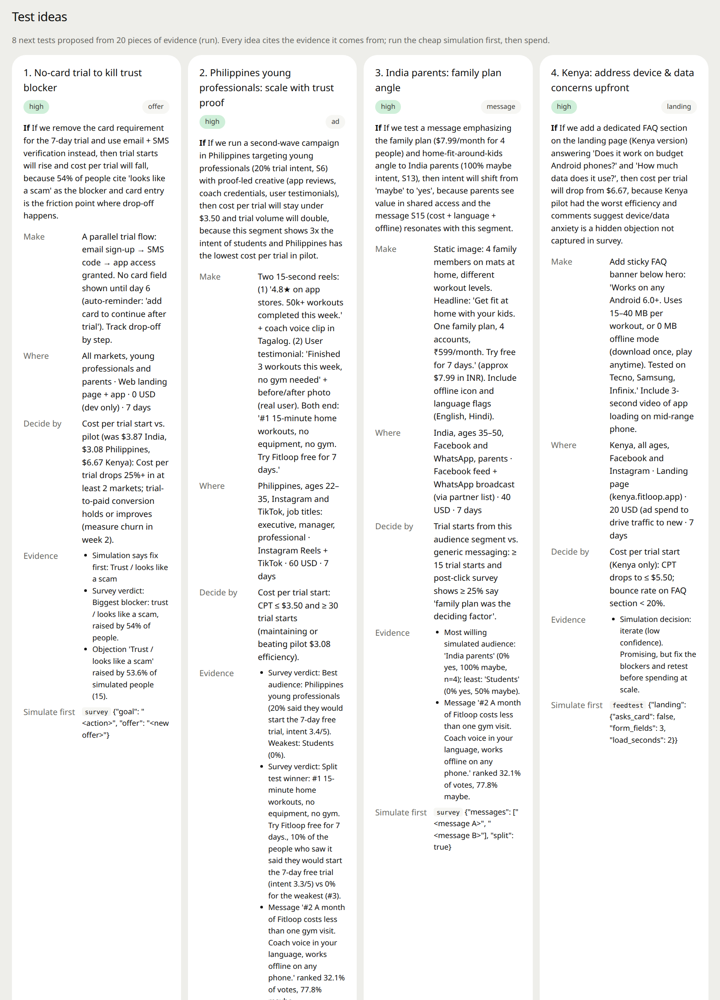
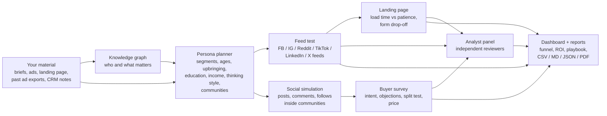

<div align="center">

# MarketMirror

**Test ads, messages, prices and launches on simulated buyers before you spend.**

Diverse AI personas scroll realistic Facebook, Instagram, Reddit, TikTok, LinkedIn and X feeds, react to your ads, answer a buyer survey and argue in their own communities. You get a marketing and sales dashboard: who converts, which message wins, what stops people, what they would pay, and what your budget would return.

Runs on Claude · works as a Claude Code skill and as MCP agent tools · one offline HTML dashboard · built on the [MiroFish](https://github.com/666ghj/MiroFish) simulation engine


</div>

## What you can do with it

| Question | MarketMirror answer | How |
|---|---|---|
| Which ad or creative should get the budget? | Thumb-stop rate, CTR, engagement, hides and comments per creative, split-tested per platform | **Feed test** in platform-styled feeds |
| Which message or offer converts, for whom? | Would-convert by segment, country, community, age and gender; winning message per audience | **Buyer survey** with true split tests |
| What should we charge? | Acceptable price range, sweet spot and "never pay" price by segment | **Van Westendorp** price questions |
| Where do we lose people after the click? | Page load on each person's network vs their patience, form drop-off with reasons | **Landing-page step** |
| Which subject line, sender and send time get opened and clicked? | Every simulated person gets a realistic inbox for the day; an attention gate decides opens, each opened mail gets a real reaction (skim, read, click, reply, unsubscribe, spam) with honest odds; sequences run over days; projection from your list size to leads | **Email test** |
| What will this cost per lead, and does it pay back? | Impressions, clicks, CPC, conversions, cost per lead, CAC, ROAS, ROI, break-even CPL, payback | **Projections** calibrated to your real CPM and CTR |
| What did our past ads actually do? | Best and worst ad sets, cost per conversion, landing-page loss, benchmarks | **`ads-import`** for Meta / Google Ads exports |
| Can we trust the simulation for this market? | Rank correlation and winner match against real ad results | **`backtest`** |
| What do the objections sound like, and how do we answer them? | Objections by audience in the buyers' own words, "what would change my mind", a sales playbook per audience | **Survey + playbook + interviews** |
| Does a second opinion agree? | Independent analysts (performance, brand, sales, psychology, data, local market) each read the anonymized evidence alone | **Analyst panel** |
| What will people say when we post or launch? | Your captions are posted inside the simulation on a schedule (teaser, launch, offer); simulated people from each country reply, quote and argue in their own languages | **Brand posts + launch calendar**, shown in the **Social feed** |
| Is the sales pitch ready? | Every simulated buyer hears the pitch, objects, asks a question back; your rebuttals are scored per objection; hot leads with the best time to reach them | **Sales rehearsal** |
| What should we test next? | Prioritised experiments from your real ad data (exports or rows from a connected ads tool) and the run, each citing its evidence, with the config to simulate it first | **Test ideas** |
| Can someone who is not technical read this? | A plain-language report (what we tested, who we simulated, what happened, objections and answers, pricing, sales notes, action plan, limits), downloadable from its header | **Report** |
| Does the conclusion survive another draw, another scenario? | The same people run through several scenarios and seeds; the study page shows spread, deltas, agreement and one conclusion with a confidence from agreement | **Studies** |
| What will it really do, and how sure are we? | Every headline number gets an interval and a basis: scaled by the real results stored from backtests and calibrations, or flagged as an uncalibrated prior; a 90-day adoption forecast | **Predict** |
| So, launch it or not? | **Go / iterate / no-go**, with confidence, the signal behind each vote and what to fix first | **Decision card** combining every test |

## See it

<table>
<tr>
<td width="50%"><br><b>Feed test.</b> Each ad looks the way it does on the platform, with the reactions and comments simulated people left. Press <i>Replay the scroll</i> to watch them scroll past, stop, react or click, one by one.</td>
<td width="50%"><br><b>Playbook.</b> For each audience: priority, what to lead with, the objection to pre-empt, how to answer it, the community to seed it in, and a proof line.</td>
</tr>
<tr>
<td><br><b>Audiences.</b> Would convert, maybe and no by segment, country, community, age and gender, with 95% margins and small-sample flags.</td>
<td><br><b>Analyst panel.</b> Five analysts each work alone on the anonymized evidence. Every theme is backed by quotes from the simulated people.</td>
</tr>
<tr>
<td><br><b>Pricing.</b> Van Westendorp curves: the acceptable range, the sweet spot and the "never pay" price by segment.</td>
<td><br><b>Objections.</b> What stops people, how often, in their own words, and what would change their mind.</td>
</tr>
<tr>
<td><br><b>Social feed.</b> Your launch posts inside the simulation: who replied from which country, in which round, with what sentiment; then every post, filterable by platform, round, audience and country.</td>
<td><br><b>Sales rehearsal.</b> Every simulated buyer hears the pitch; objections, the questions they ask back, how each rebuttal did, and whom to call first.</td>
</tr>
<tr>
<td><br><b>Report.</b> Written for anyone: what we tested, who we simulated, what happened, objections and how to answer them, pricing, sales notes, action plan, limits. Every download sits in its header.</td>
<td><br><b>Test ideas.</b> The next experiments, from your real ad data and the run, each citing its evidence and carrying the config to simulate it first.</td>
</tr>
</table>

**Demo run.** These screenshots come from a real launch simulation of **Fitloop**, a made-up home-workout app with a 7-day trial at $4.99 a month, on 28 interview-grounded simulated people (young professionals, parents and students in India, the Philippines and Kenya, each with a phone, a data plan and a life story in their own words). Five ads ran in Facebook, Instagram, TikTok and Reddit feeds; the brand's own teaser, launch, offer and "no card" posts were published inside six rounds of social simulation; everyone answered the buyer survey and heard the sales pitch. The brand, the audiences and the pilot numbers in its brief are all invented.
- **Decision:** iterate, low confidence. Survey, feed test and all five analysts said iterate (success chance 31%).
- **Social feed:** the launch posts drew 11-13 replies each on Reddit, mostly positive, and 7-13 quote-tweets on X; people asked, in Hindi, Taglish and Kenyan English, whether it works offline on an old Android, whether the trial auto-charges, and for proof from someone in their city.
- **Survey:** 4% would start the trial, 71% maybe; purchase intent 3.2/5 ± 1.1. Trust ("looks like a scam", 54%) was the blocker, then "unclear what it is". Philippines young professionals were the only group with firm yeses (20%).
- **Sales rehearsal:** pitch score 39/100; after rebuttals 7% yes and 64% maybe. The trust rebuttal moved under half of the objectors, and people asked for testimonials from working mothers in India and real users in the Philippines. 12 hot leads with the best channel and time to reach them.
- **Price:** acceptable $3 to $15, sweet spot about $3.
- **Test ideas:** 8 next experiments, led by a no-card trial flow and a proof-led creative for the Philippines, each citing its evidence.

These numbers come from simulated people. Treat absolute rates as pessimistic until a backtest calibrates them, and use the run to rank options, find objections and plan tests.

## How it works



1. **Personas.** You describe audience segments (country, age range, role, count, languages, platforms, what you know about them). Every segment gets concrete people: ages spread across the range, balanced genders, rotating cities, and balanced upbringing (city, small town, village, migrant family), education, income, thinking style (analytical, sceptical, price-hunter, early adopter, traditional, busy...), tech comfort and media diet. Each person has one deliberate contradiction so nobody reads like a stereotype, and a realistic local name that is invented, never a real person. Or let Claude plan the segments from your question.
2. **Communities.** People join the groups where they actually talk (a parents' WhatsApp group, a subreddit, a Facebook group) and pick up each group's norms. Members follow each other before the simulation starts, so feeds are mostly in-group, with a small cross-group bridge.
3. **Feed test.** Each person scrolls a feed of local organic posts with one test ad, the way each platform shows ads. See [How realistic is it?](#how-realistic-is-it) for what keeps this honest.
4. **Social simulation (optional).** Personas post, comment and follow on simulated Twitter and Reddit for a few rounds (the MiroFish / OASIS engine), so word of mouth and group dynamics play out.
5. **Buyer survey.** Everyone answers the same questionnaire: interest, trust, purchase intent and whether they would recommend it, first in their own words and then as quick numbers; would click, the message that works (or a single assigned message in a split test), main objection, what would change their mind, a quote, and optional price questions. The free-text answers become rating distributions (see [How realistic is it?](#how-realistic-is-it)).
6. **Analyst panel.** Several analysts with different lenses each read the anonymized evidence alone, then the panel reports where they agree.
7. **Dashboard.** One self-contained HTML file (Apache ECharts inlined, works offline), live while the run happens, with downloads for every report.

## Quick start

### Step zero: let it understand your product

```bash
mm understand --docs brief.md pricing.md --url https://yourbrand.com --ads export.csv --name Acme
```

One Claude call reads everything you have into a **product profile**: what it is, for whom and where, pricing and offer, proofs, differentiators, competitors, channels, the objections your material already predicts, brand voice, the KPIs you watch, and what is still unknown. `quickstart --from-docs ...` prefills its questions from it; `market-test` builds it right after upload (so the market map gets Brand, Product, Competitor and Objection nodes), and every later step (persona planning, feed test, survey wording, pitch, report, test ideas) reads it. The MCP tool is `understand`.

### Easiest: `quickstart`

```bash
git clone https://github.com/DarkWorldCoder/market-mirror && cd market-mirror
cd backend && uv sync --python 3.12 && cd ..
bash backend/claude_cli/start_server.sh
backend/.venv/bin/python backend/claude_cli/mirofish.py quickstart
```

It asks nine plain questions (brand, what you sell, who buys and where, platforms, what to test, budget, how many people, past ad export, extra documents), creates `.env` and asks for your Anthropic key if there is none (typed hidden, never printed), writes a scenario folder with template ads, messages, a launch calendar, a pitch and rebuttals, builds the simulated people and stops before any paid step. Edit the templates, then run the printed command. Agents call it with `--answers @answers.json`, or through the `quickstart` MCP tool.

### No API key? Run on your Claude Code or ChatGPT login

```bash
mm gateway start claude      # or: codex   (plugin helper), or by hand:
python backend/gateway/local_gateway.py --backend claude --workers 6
```

The gateway is a tiny OpenAI-compatible server on `http://127.0.0.1:5055/v1` that answers every model call by running `claude -p` (Claude Code, your Claude subscription) or `codex exec` (your ChatGPT subscription). `.env` then says `LLM_PROVIDER=openai`, `LLM_BASE_URL=http://127.0.0.1:5055/v1`, `LLM_API_KEY=gateway`, `LLM_GATEWAY=claude|codex`; nothing else changes. `quickstart` and `doctor` offer it when no key is found. Be aware: each call starts a CLI process (about 3-8 s, so a 150-person run takes hours rather than an hour), your subscription's rate limits apply, identical prompts are cached in SQLite so reruns are free, and both vendors allow subscription use through their own tools for your own work, not inside a product you resell: use an API key for teams and clients. Any OpenAI-compatible local model works the same way (`LLM_PROVIDER=openai` and the Ollama / LM Studio / vLLM URL).

### As a Claude skill (recommended)

In Claude Code:

```
/plugin marketplace add DarkWorldCoder/market-mirror
/plugin install market-mirror@market-mirror
```

Then just ask, for example: *"Test these three Facebook ads on parents in Jakarta and Surabaya; here is our landing page and last month's Ads Manager export."* The skill downloads the engine, sets it up, asks for your Anthropic key, plans personas, stops to show them to you before spending, runs the tests and opens the live dashboard. It also pulls real data from tools you have connected (Meta Ads, Google Ads, Semrush, web search, your CRM exports).

You can also copy `plugin/skills/market-mirror/` into `~/.claude/skills/`. The skill needs a shell, `git` and [`uv`](https://docs.astral.sh/uv/).

### As agent tools (MCP)

The plugin also starts an MCP server, so Claude Desktop, Claude Code or any MCP client gets these tools: `doctor`, `setup`, `start_backend`, `quickstart`, `market_test` (everything in one call), `job_status`, `results`, `list_runs`, `start_live`, `ads_import`, `ideas` (pass rows you pulled from Meta/Google/TikTok Ads tools), `pitch`, `backtest` and `cli`. An agent with an ads connector can therefore read the account, propose tests, simulate them and report, without the user touching a file. To add it by hand:

```bash
claude mcp add market-mirror -- python3 /path/to/market-mirror/plugin/skills/market-mirror/scripts/mcp_server.py
```

### One command for everything

```json
{
  "name": "acme_launch", "title": "Acme Pro launch test",
  "seeds": ["brief.md", "past_ads.md", "landing_page.md"],
  "requirement": "question.txt",
  "personas": "personas.json",
  "creatives": "creatives.json",
  "seeds_n": 3,
  "posts": "posts.json", "events": "events.json",
  "rounds": 6,
  "survey": {"offer": "Acme Pro trial", "goal": "start a free trial", "messages": "messages.txt", "split": true, "pricing": "USD"},
  "pitch": {"script": "pitch.md", "rebuttals": "rebuttals.md", "channel": "dm"},
  "panel": {"analysts": 5, "brief": "Which audience and message get the budget, and should we launch?"},
  "report": true,
  "approve_spend": false
}
```

```bash
mm market-test scenarios/acme/market_test.json   # 1st run: builds the people, then stops so you can check them
# add "simulation_id" from the output and "approve_spend": true, run again:
# feed test -> brand posts + launch calendar inside 6 rounds -> survey -> pitch rehearsal -> analyst panel -> report -> dashboard
```

### By hand

```bash
git clone https://github.com/DarkWorldCoder/market-mirror && cd market-mirror
cp .env.example .env                 # set LLM_API_KEY=<your Anthropic key>
cd backend && uv sync --python 3.12 && cd ..
bash backend/claude_cli/start_server.sh
alias mm="backend/.venv/bin/python backend/claude_cli/mirofish.py"

# 1. personas (stop before paid rounds and look at them)
mm run --seed scenarios/acme/brief.md scenarios/acme/past_ads.md \
       --requirement @scenarios/acme/question.txt --personas scenarios/acme/personas.json \
       --stop-after prepare --out mirofish_runs/acme
mm profiles --simulation <sim_id> --brief

# 2. ads in real-looking feeds, with landing page, projections and ROI
mm feedtest --simulation <sim_id> --creatives @scenarios/acme/creatives.json --exposures 2 --seeds 3

# 3. a few rounds of social simulation, then the buyer survey (split test + price)
mm start  --simulation <sim_id> --max-rounds 3
mm survey --simulation <sim_id> --offer "Acme Pro trial" --goal "start a free trial" \
          --messages @scenarios/acme/messages.txt --split --pricing USD

# 4. second opinion, then watch everything live
mm panel --simulation <sim_id> --analysts 5 --brief "Which audience and message get the budget?"
mm live                              # http://127.0.0.1:5050/
```

Keep your own inputs in `scenarios/<name>/`. That folder is gitignored, and so is `mirofish_runs/`.

## Recipes

| Recipe | You provide | Run |
|---|---|---|
| **Ad / creative test** | ads (text, headline, CTA, image or description, platform, targeting) | `feedtest --creatives @creatives.json --seeds 3` |
| **Message / offer split test** | 2+ messages, the conversion goal | `survey --messages @messages.txt --split` |
| **Price test** | offer description, currency | `survey --pricing USD` |
| **Landing page check** | load time, language, form fields, price | `landing` block in `creatives.json` |
| **Spend, CPL and ROI** | CPM and budget (or an ads export); optional lead value, close rate, deal value, margin | `benchmarks` block, or `--benchmarks @past_ads.json` |
| **Past-ads analysis** | Meta Ads Manager / Google Ads CSV or JSON export | `ads-import export.csv --out scenarios/x/past_ads.md` |
| **Backtest** | 3+ past ads recreated as creatives with `"real_ad"` names | `backtest --run-dir ... --actuals past_ads.json` |
| **Product or feature launch** | announcement, your captions, a calendar (`events.json`: `[{"round": 2, "agent": "Brand", "platform": "both", "content": "..."}]`) | `run --posts @posts.json --events @events.json --max-rounds 6`; watch the **Social feed** |
| **Captions in the platform's voice** | a brief (and a previous run's objections) | `captions --brief @brief.md --platform instagram --n 6` -> use as posts, creatives or messages |
| **Sales pitch rehearsal** | pitch or call script, rebuttals per objection type (`## price`, `## trust`, `## any`) | `pitch --simulation <id> --script @pitch.md --rebuttals @rebuttals.md --channel call` |
| **What to test next** | Ads Manager export, or rows from a connected ads tool, plus a previous run | `ideas --ads export.csv --run-dir mirofish_runs/x --brand Acme` |
| **Plain-language report** | a finished run | `report --simulation <id> --run-dir mirofish_runs/x` (written by `market-test` automatically) |
| **Email campaign** | emails (sender, subject, preheader, body, CTA, send time, sequence steps), list size | `emailtest --simulation <id> --emails @emails.json --list-size 10000`: inbox simulation, open/click/unsubscribe/spam per variant and audience, subject-line ranking, sequence funnel, projection to leads and revenue, spam-word warnings |
| **Anything else: one spec** | `{"type": "ad|message|price|offer|positioning|naming|landing|launch|pitch|email|creator_post|channel_mix", "variants": [...]}` | `test --simulation <id> --spec @experiment.json` -> `experiment_result.json`: each variant's metric with a 95% margin, winner, lift, clear or tie, how to read it |
| **Several scenarios, one conclusion** | a base config, scenario overrides (offer, price, messages, posts), seeds | `study --spec study.json`: every scenario x seed runs on the same people; `study_summary.json` has mean, spread and 95% interval per metric, deltas, winner stability, the decision agreement matrix and a conclusion with a confidence that comes from agreement; `study_report.md` and `study.html` |
| **Predictions that say what they rest on** | a finished run, optional targets | `predict --run-dir mirofish_runs/x --brand Acme --target ctr=2 cpl=10`: CTR, CPL, would-convert and email click predictions with 95% intervals, scaled by every real result stored so far (`backtest`, `calibrate`), labelled "calibrated on N real results" or "uncalibrated prior"; plus a 90-day adoption forecast with the word of mouth seen in the rounds |
| **Reliability check** | nothing extra | `survey ... --retest 20`: twenty people answer again a simulated week later; agreement is reported |
| **Trust / correct / walk away** | 50-300 real answers (CSV: segment, country, gender, age, y) | `calibrate --run-dir mirofish_runs/x --real answers.csv [--map y=Converted]` -> `calibration.json` with the verdict per audience and an AIPW-corrected rate |
| **Second opinion** | anything above | `panel --analysts 5` |

<details>
<summary><b>Input formats</b> (personas.json, creatives.json)</summary>

**personas.json**

```json
{
  "segments": [
    {"label": "Philippines parents", "count": 8, "country": "Philippines", "cities": ["Manila", "Cebu City"],
     "age_min": 35, "age_max": 50, "role": "parent who wants to get fit at home", "entity_type": "Parent",
     "languages": ["Tagalog", "English"], "platforms": ["Facebook"],
     "notes": "Pilot: cheapest cost per trial; many drop at the card step", "gender_mix": "balanced",
     "diversity": {"income": ["lower-middle", "middle", "upper-middle"]}}
  ],
  "communities": [
    {"name": "Fit Pinoy Community", "kind": "facebook_group", "segments": ["Philippines parents"],
     "norms": "encouraging, Taglish posts, before/after photos", "join_share": 0.9, "account": true}
  ],
  "keep_entities": ["Your brand"], "graph_agents": "auto", "in_group_follows": 6, "bridge_rate": 0.05
}
```

Up to 500 people per segment and 2,000 in total. `--auto-personas N` plans segments and communities for you. Optional keys: `"probes": false` skips the second interview call (adaptive follow-ups, product questions, BDE card); `"population": {"India": {"age": {"18-24": 0.32, "25-34": 0.28, ...}, "gender": {"female": 0.49, "male": 0.51}}}` rakes each person's `weight` to the census-like shares you give, so weighted rates reflect the real mix (bring the shares from your census or ad-platform reach data; none are shipped).

**creatives.json**

```json
{
  "creatives": [
    {"id": "fb1", "platform": "facebook", "format": "image", "page": "Acme", "link": "https://acme.com",
     "text": "Primary text...", "headline": "Headline", "cta": "Sign up",
     "media": "what the image or video shows", "image": "optional/local/image.png",
     "segments": ["optional targeting"], "countries": ["optional"], "real_ad": "optional name in your ads export"}
  ],
  "landing": {"load_seconds": 3.5, "language": "English", "shows": "what the page shows",
              "form_fields": ["full name", "email", "phone number"], "price": "free", "steps": 1},
  "benchmarks": {"facebook": {"cpm": 2.1, "ctr": 1.4, "budget": 500, "currency": "USD",
                              "lead_value": 12, "close_rate": 0.1, "deal_value": 300, "gross_margin": 0.8, "monthly_value": 25}}
}
```

Platforms: `facebook`, `instagram`, `reddit`, `tiktok`, `linkedin`, `x`. Several creatives on one platform are split-tested automatically.

In the `market-test` config, `seeds` lists your documents and `seeds_n` is how many times to repeat the feed test with different random seeds (same as `feedtest --seeds N`).
</details>

## The dashboard

Sections, in order: **Decision** (go / iterate / no-go), **Report** (plain language, with every download button in its header), **Results** (verdicts and headline numbers), **Ratings** (free-text answers as 1-5 distributions, mean ± spread per audience), **Playbook**, **Sales rehearsal**, **Test ideas**, **Feed test** (range across seeds, post mocks with scroll replay, metrics, landing funnel, projections and ROI), **Social feed** (every post of the simulation by platform, round, audience and country, with likes, quotes, reposts and comments; a brand-posts strip with reach and reply sentiment), **Funnel**, **Audiences**, **Objections**, **Messages** (split-test ranking and an audience × message heatmap), **Pricing** (Van Westendorp curves), **Voices**, **Analysts**, **Backtest**, then the people (cards with their interview summary, phone and data plan, groups, what they did, their objection and lead score), activity over time, the market map (brand, competitors, segments, communities, countries, objections and benefits, all connected) and run details.

**The report** is one Claude call over a compact fact sheet of the whole run (decision, ads, survey by audience, objections with quotes, pricing, panel, social feed, people). Its sections are fixed (what we tested, who we simulated, what happened on social media, ad results, survey results, objections and how to answer them, pricing, sales notes with ICP and first messages, action plan, limits and confidence), every number is checked against the fact sheet, and it is rendered deterministically to Markdown. If the model fails, a data-only version is written instead.

**Downloads (in the report header):** this page (HTML), print or save as PDF, the report (Markdown), the action plan (JSON), every survey answer and every feed session (CSV), results by audience and creative metrics with ROI (CSV), lead scores (CSV), the sales rehearsal and the social feed (JSON), test ideas (Markdown) and all key numbers (JSON). The same files are written next to `dashboard.html`.

## How realistic is it?

LLM personas are known to be too positive, too uniform, too eager to engage and too rational. MarketMirror builds in what the 2024-2026 research on synthetic consumers supports, and it tells you when not to trust a number:

- **People, not labels.** Every simulated person is built from a balanced demographic slot (age, gender, city, upbringing, education, income, thinking style, tech comfort, media diet, one contradiction) and then **interviewed**: twelve life questions, two adaptive follow-ups chosen from their own answers (money pressure, a scam story, who they ask before buying, what annoys them in ads), and three questions about your product. Interview-grounded agents reproduce people's answers far better than demographic prompts ([Park et al. 2024](https://arxiv.org/abs/2411.10109); [AI-moderated interviews beat demographics-only twins](https://arxiv.org/abs/2609.29143)).
- **Structure beats length.** The interview is distilled into a **BDE card**: Background (who they are, what they believe, how much they agree to be polite, where their words and actions differ), Decision procedure (who they ask, how fast, maximiser or satisficer, risk, patience, what makes them act or close the tab) and Evaluation profile (spare money, what they pay for, dealbreakers, trust cues). Organising persona information this way predicted better than raw transcripts on Twin-2K-500 ([arXiv 2608.20344](https://arxiv.org/abs/2608.20344)).
- **A stereotype guard.** Digital twins tend to collapse into group stereotypes and hyper-rational reasoning ([Funhouse Mirrors](https://arxiv.org/abs/2509.19088); [sociodemographic prompting](https://arxiv.org/abs/2507.16076)). After generation the planner measures variety per audience, repairs people who share an occupation and city, never shows the model a segment label as an identity, and tells people that gut feeling, habits and time pressure are allowed.
- **Chances, not single picks.** Simulated populations collapse onto one default answer when each person picks once ([distribution-first simulation](https://arxiv.org/abs/2607.18310)). The survey, the feed test and the email test ask every person for their odds (yes / maybe / no, adding to 100) as well as a pick ([Verbalized Sampling](https://arxiv.org/abs/2510.01171)); the dashboard reports the expected rates next to the realised ones and flags audiences whose odds are suspiciously identical.
- **Ratings from free text.** Asked for a number, models bunch in the middle. People answer interest, trust, intent and recommendation in their own words first; each verdict clause is mapped to a 1-5 distribution by similarity to anchor statements with the local embedding model (semantic similarity rating, which reproduced real purchase-intent distributions across 57 surveys: [Maier et al. 2025](https://arxiv.org/abs/2510.08338)). The same rating is applied to how people answer a sales pitch.
- **Attention is decided in code**, leaving is the default, social proof is damped, frequency wears out, and the click is not the conversion (page load on the person's network, patience, language and form fields decide); every rate shows a 95% margin and small samples are flagged; `--seeds N` repeats the feed test and the decision card only says go when every seed agrees.
- **Test-retest.** `survey --retest 20` re-asks twenty people a simulated week later and reports how often they gave the same verdict, the reliability figure the persona papers use.
- **Trust, correct or walk away.** With 50-300 real answers (a real survey, your Ads Manager export, email stats) `calibrate` runs the diagnostics of [When can you trust your synthetic users?](https://arxiv.org/abs/2609.13148): covariate overlap between your real customers and the simulated panel, a calibration check per audience, and a doubly-robust (AIPW) corrected estimate with cross-fitting. The verdict and the corrected number go into `calibration.json` and the report.
- **What the papers warn about.** Twins are *distribution-calibrated but identity-imprecise* ([arXiv 2603.29890](https://arxiv.org/abs/2603.29890); individual correlation around r = 0.2 on Twin-2K-500 while aggregate curves track): audience-level and market-level findings are the trustworthy layer, so every per-person number (lead scores, "call these first") is a ranking signal, not a prediction about that person. Price answers are low-confidence without real price data ([MSI](https://www.msi.org/working-paper/using-llms-for-market-research-2/)), and real campaigns can still surprise ([arXiv 2609.25010](https://arxiv.org/abs/2609.25010)). Use MarketMirror to rank options, find objections and plan tests, then confirm with a small real budget. When a backtest or a calibration disagrees with reality, trust reality.

## Costs

Everything runs on your own Anthropic key. Defaults use `claude-haiku-4-5`.

- **Personas:** about one call per 8 people.
- **Feed test:** one call per exposure that catches someone's eye (typically 15-35%), plus one per click for the landing page. `--seeds N` multiplies this by N; the log shows calls and tokens per seed.
- **Rounds:** one call per active agent per round.
- **Survey:** one call per person. Mapping the free-text answers to ratings runs on the local embedding model and is free.
- **Panel:** one call per analyst. **Pitch:** one call per person, plus one per objector for the rebuttal. **Report** and **ideas:** one call each.

Measured on the Fitloop runs (`claude-haiku-4-5`, 12 parallel calls, feed test with 5 ads, 6 rounds with launch posts, survey with split test and price questions, pitch with rebuttals, 5 analysts, report). Calls are counted from the logs (one per feed exposure that caught the eye, one per logged agent action, one per survey or pitch answer); dollar figures are estimates from those counts at Haiku list prices, so check your Anthropic console for the exact bill.

| Size | People | Claude calls (about) | Wall time (measured) | Cost (about) |
|---|---|---|---|---|
| small | 28 | 500 | 26 min (14 for the people, 12 for the tests) | 3 USD |
| medium | 60 | 800 | 40 min | 5 USD |
| large | 150 | 1,500 | 54 min (13 for the people, 41 for the tests) | 10 USD |
| max | 2,000 | 20,000+ | hours; run one platform, fewer rounds, raise `--parallel` | 100+ USD |

In the 150-person run, 64% of agent turns were a scroll past (`do_nothing`), which is what keeps the rounds cheap and the feeds realistic.

Always stop after `prepare` and look at the people before spending on the rest. `--parallel` defaults to your CPU count.

## Under the hood

| Part | Where |
|---|---|
| Persona planner, communities, follow graph | `backend/app/services/persona_planner.py` |
| Feed test, landing page, projections and ROI | `backend/app/services/feed_test.py` |
| Analyst panel | `backend/app/services/analyst_panel.py` |
| Per-round persona cards, action budgets, brand posts and launch events inside OASIS | `backend/scripts/agent_context.py`, `event_schedule.py` |
| Real post view (feed story) | `backend/app/services/feed_story.py`, dashboard `social_feed.py` |
| Plain-language report | `backend/app/services/market_report.py`, dashboard `report_view.py` |
| Sales rehearsal | `backend/app/services/pitch.py` |
| Test ideas from real ad data | `backend/app/services/ideas.py` |
| Quickstart wizard | `backend/claude_cli/quickstart.py` |
| Product profile (understand) | `backend/app/services/product_profile.py`, `backend/app/api/product.py` |
| No-key gateway (Claude Code / Codex logins) | `backend/gateway/local_gateway.py` |
| API | `backend/app/api/market.py` (+ upstream `simulation.py`) |
| CLI | `backend/claude_cli/mirofish.py`, `market_cli.py` |
| Survey analysis, playbook, pricing | `backend/claude_cli/marketing.py` |
| Free-text ratings (SSR) | `backend/app/services/ssr.py` |
| Dashboard | `backend/claude_cli/exporter.py`, `feed_view.py`, `vendor/echarts.min.js` |
| All-in-one command | `mirofish.py market-test` |
| MCP server (agent tools) | `plugin/skills/market-mirror/scripts/mcp_server.py` |
| Claude skill | `plugin/skills/market-mirror/` |

Claude runs through Anthropic's OpenAI-compatible endpoint. Memory is a free local knowledge graph (SQLite with BM25 and local multilingual embeddings), so no Zep account is needed. `CLAUDE.md` is the full operating guide for agents, and `HANDOFF.md` lists known gaps. Run the tests with `cd backend && uv run --no-sync python -m pytest tests claude_cli/tests -q`.

## Credits and license

MarketMirror is built on [MiroFish](https://github.com/666ghj/MiroFish) (simulation engine, AGPL-3.0) and [OASIS](https://github.com/camel-ai/oasis) (social simulation). The original MiroFish README is kept at [docs/MIROFISH-UPSTREAM.md](docs/MIROFISH-UPSTREAM.md). The dashboard embeds [Apache ECharts](https://echarts.apache.org) 5.5.1 (Apache-2.0, see `backend/claude_cli/vendor/`). MarketMirror is released under AGPL-3.0.
