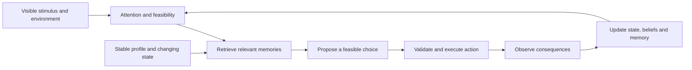

# Human behavior research for MarketMirror

Reviewed 19 October 2026. This is an engineering reading guide and implementation proposal. The mechanisms proposed below have not been validated in MarketMirror against human behavior. Paper results describe their own populations, tasks and model versions.

## Main finding

Build agents with grounded preferences, limited observations, persistent state, selective memory and observable consequences. Evaluate their choices against real behavior. More detailed biographies, more reasoning tokens and more simulated people do not by themselves establish validity.

Distinguish three outcomes: a believable character, a stable individual simulation, and a useful prediction about a real audience. Each requires a different evaluation. Synthetic interviews elaborate a fictional profile; real interviews provide evidence about an actual participant. They must have different provenance labels.

## Papers and engineering implications

### 1. Memory, reflection and planning

[Park et al., Generative Agents: Interactive Simulacra of Human Behavior (2023)](https://arxiv.org/html/2304.03442v2). Read architecture, ablations and evaluation, sections 4–7. Selective retrieval combines recency, importance and relevance; reflections and plans feed back into memory. Ablations support their contribution to perceived believability. This sandbox evaluation does not establish marketing prediction accuracy. Implement timestamped episodic memories and evidence-linked reflections; test whether retrieval improves decisions rather than merely producing richer dialogue.

### 2. A modular cognitive architecture

[Sumers et al., Cognitive Architectures for Language Agents (CoALA)](https://arxiv.org/html/2309.02427v3). Read sections 4–6. The framework separates working, episodic, semantic and procedural memory, and organizes decision-making around proposing, evaluating and selecting actions. It is an architectural framework, not proof of human fidelity. Use explicit state and a constrained executor around the language model.

### 3. Real self-reports improve some predictions

[Park et al., LLM Agents Grounded in Self-Reports Enable General-Purpose Simulation of Individuals, v3 (2026)](https://arxiv.org/pdf/2411.10109v3). This updates the paper originally titled *Generative Agent Simulations of 1,000 People*. Read results, discussion and methods. The 1,052-person study reports held-out GSS accuracy at 83%, 82% and 86% of human test–retest consistency for interview, survey and combined agents, versus 74% for demographics-only agents. These are normalized benchmarks, not raw accuracy or universal behavioral fidelity. Economic-game predictions did not significantly improve over the demographic baseline. Import real self-reports when available, preserve their source, and reserve outcomes for testing.

### 4. Structure helps in a task-dependent way

[Ye, Deng and Candogan, Beyond Raw Transcripts: Structured Persona Extraction for LLM-Based Digital Twins (2026 preprint)](https://arxiv.org/html/2608.20344v1). Read sections 3–5. Background–Decision procedure–Evaluation (BDE) improved predictions on Twin-2K-500, but the fixed schema did not consistently generalize to heterogeneous tasks. Task-specific extraction performed better in the broader setting. Keep BDE as a candidate representation and compare it with raw evidence, short summaries and simpler profiles on untouched outcomes. Do not optimize extraction prompts on the final test set.

### 5. Richer interviewing is not automatically better prediction

[Deng et al., AI-Moderated Interviews for Market Research and Digital Twins Calibration (2026 preprint)](https://arxiv.org/html/2609.29143v1). Read study design, digital-twin evaluation and discussion. AI interviews recovered useful customer needs and outperformed demographic-only profiles for predicting held-out marketing responses. Their additional richness did not improve quantitative prediction over static interviews in this study. Support short structured intake as well as transcripts; judge their marginal value empirically.

### 6. Free-text elicitation and semantic ratings

[Maier et al., LLMs Reproduce Human Purchase Intent via Semantic Similarity Elicitation of Likert Ratings (2025 preprint)](https://arxiv.org/html/2510.08338v1). Read methods, discussion and limitations. Free-text responses mapped to rating distributions performed well across 57 personal-care concept surveys. The anchors were manually optimized for those surveys; subgroup fidelity, embedding choices and transfer remain limitations. Retain SSR as an optional measurement method. Version anchors and embedders, test mappings on separately labeled answers, and keep purchase intent separate from actual purchasing. MarketMirror's local embedder and verdict-clause extraction are adaptations, not the paper's exact replication.

### 7. Matching averages can conceal failure

[Bisbee et al., Synthetic Replacements for Human Survey Data? The Perils of Large Language Models (Political Analysis, 2024)](https://www.cambridge.org/core/journals/political-analysis/article/synthetic-replacements-for-human-survey-data-the-perils-of-large-language-models/B92267DC26195C7F36E63EA04A47D2FE). Read results and robustness analyses. Synthetic responses could approximate overall means while underrepresenting variation and misrepresenting associations and subgroups; outputs also changed with prompting and collection time. Check distributions, covariance, minority segments and temporal drift. A matching overall conversion average is insufficient validation.

### 8. A persona panel can lose to a simpler ranker

[Maiorano, Do Synthetic Personas Predict Real Audience Response? (2026 preprint)](https://arxiv.org/html/2609.25010v1). Read sections 3–7. On 399 reliable-winner Upworthy packages, a generic-reader model achieved 49.2% top-choice accuracy versus 34.6% for a ten-persona panel; the evaluation used matched sampling budgets. This finding concerns the tested copy-ranking protocol and does not invalidate every use of personas. Add a generic-reader LLM comparator, equalize query budgets, retain ties and uncertain real outcomes, and compare within actual experiments. A training-mean baseline is useful but is a different comparator.

### 9. Personality coherence is a separate benchmark

[Peng et al., HEART-Bench: Do LLM Agents Exhibit Human-like Psychology? (2026 preprint)](https://arxiv.org/html/2605.30058v1). Read benchmark construction, results and limitations. The benchmark evaluates context-sensitive decisions for constructed Big Five characters with autobiographical memories. Expert-validated fictional-character choices are the reference, not observed purchases by real customers. Use this style of evaluation to test consistency across situations, without presenting it as commercial predictive validation or assuming its extreme-trait character distribution represents customers.

### 10. Social agreement can be an emergent model artifact

[Ashery, Aiello and Baronchelli, The Dynamics of Social Conventions in LLM Populations (2024 preprint version)](https://arxiv.org/html/2410.08948v1). Read experiment design and collective-bias analysis. Repeated local interactions can create collective biases even when initial individual choices appear neutral. Treat simulated social consensus as an outcome requiring validation. Compare social and isolated conditions, track visible exposure paths, and measure correlated responses; agent agreement is not independent evidence of market demand.

### 11. Validation must match the intended claim

[Hullman et al., This Human Study Did Not Involve Human Subjects: Validating LLM Simulations as Behavioral Evidence (2026 preprint)](https://arxiv.org/html/2602.15785v1). Read the distinction between heuristic repair and statistical calibration. Prompt repair can support exploration, while confirmatory inference needs human data and explicit identification assumptions. Use simulations to discover objections and prepare experiments; only promote a specific predictive claim after suitable held-out validation.

### 12. Cross-country fidelity remains weak

[Chen et al., Simulated Responses from Large Language Models Are Weak Proxies for Human Economic Preferences Across 74 Countries (Nature Human Behaviour, 2026)](https://www.nature.com/articles/s41562-026-02611-4). Read methods, results and discussion; full text accessed through the Jina reader when the direct reader encountered the publisher redirect. Across economic-preference tasks, the evaluated configurations explained little individual or country-level variance despite some demographic agreement. Models could agree with each other while disagreeing with humans. Validate language, market and task separately; agreement between providers does not establish human fidelity.

Additional calibration reading: [Tigre and Souto, When Can You Trust Your Synthetic Users? (2026 preprint)](https://arxiv.org/html/2609.13148v1), especially sections 4–8. The overlap and conditional-calibration diagnostics are useful candidates. Its decision thresholds are heuristic, its practical minimum calibration sample is unresolved, and independence assumptions require care in interacting-agent simulations. It does not justify a universal minimum respondent count or treating the synthetic population size as the number of independent human observations.

## Emotion layer (implemented, not validated)

Added 31 October 2026; full notes and references in [emotion-research-2026-10.md](research/emotion-research-2026-10.md). Code: `backend/app/services/emotion.py`, with plumbing in `behavior_state.py`, the feed, email, survey and pitch prompts, `ssr.py` (affect anchors), `focus_group.py`, `say_do.py`, `evidence.py` and `claude_cli/bench.py`.

Layers (ALMA): stable affect traits from the decision card → one appraised emotion per stimulus (12 labels, fixed OCC/Scherer-style rules, intensity ≤ 0.85, a relevance gate that keeps "nothing much" common) → a pleasure/arousal/dominance mood that decays to each person's baseline (time constant 12-48 simulated hours; brand liking about a week).

Modes: `MM_EMOTIONS` / `--emotions` / config `emotions`. `off` leaves every prompt byte-identical; `observe` (default) records and reports; `on` also lets feelings steer, through these couplings (all bounded multipliers on existing probabilities, no new random draws):

| Coupling | Range | Direction | Source |
|---|---|---|---|
| ad notice | ×0.75-1.25 | arousal up, brand dislike down | affect-as-information |
| ad wear-out | ×1.0-1.5 | faster after irritation | |
| landing patience | ×0.8-1.15 | tense and unhappy wait less | |
| wallet threshold | ×0.85-1.15 | fear down, confidence and FOMO up | Lerner & Keltner 2001 |
| polite back-out | ×0.8-1.3 | anticipated regret up, trust down | Zeelenberg & Pieters 2007 |
| email open | ×0.8-1.2 | liking the sender up | |
| social actions | ×0.8-1.2 | arousal up, sadness down | Berger & Milkman 2012 |
| pitch turn 2 | skip | walk-aways get no rebuttal | Chen et al. 2026 |

`MM_EMOTION_WEIGHT` scales them all or one at a time; every moved row records `emotion_effects`.

Checks that do not trust the model's own label: the words check (stated pleasantness against SSR valence of the person's own words), focus-group private vs in-the-room feelings (masking, over-convergence), and population flags (too uniform, positive skew, caricature). The report and dashboard label the effect "assumed sizes, not validated".

Default-flip gate (`bench.flip_gate`): `on` becomes the default only if the feelings panel is at least as accurate as `persona_panel` and `generic_reader` on Upworthy, `twin_affect` is no worse than `twin` on Twin-2K-500 (accuracy and Brier score), at least 30% of feelings are "nothing much" with no caricature flag, and pleasantness runs against real clicks (Robertson et al. 2023). Until then the default stays `observe`.

## Current code and gaps

These observations come from the working checkout, not from paper claims:

- [persona_planner.py](../backend/app/services/persona_planner.py) already has demographic slots, synthetic interviews and BDE cards. Several diversity values are balanced across slots. Balanced variety is not an empirically representative joint distribution. Generated interview answers are synthetic evidence.
- [agent_context.py](../backend/scripts/agent_context.py) provides per-round budgets, moods and bounded chat history. Moods are sampled per round; the inspected layer does not make them consequences of previous experiences. A bounded history window is different from a provenance-aware long-term episodic memory system.
- [feed_test.py](../backend/app/services/feed_test.py) implements attention gates, wear-out, social proof and landing actions. Notice rates, behavior distributions and wear-out factors are hand-set priors. Habits currently depend on the experiment seed as well as agent identity. Separate stable identity from episode randomness before interpreting longitudinal behavior.
- [ssr.py](../backend/app/services/ssr.py) provides a local embedding-based rating method. It needs domain and language validation against human-labeled responses; an embedding score is not an observed purchase probability.
- [predict.py](../backend/app/services/predict.py) compares a ratio-calibrated estimate with the training mean on declared held-out rows. That is not the generic-reader LLM comparator in the headline paper. A small MAE improvement alone is insufficient evidence of broadly reliable prediction; add grouped uncertainty, sample-size justification and independent replication.

## Proposed behavior model

This is an engineering hypothesis to evaluate, not an implemented feature or a scientifically established universal human model.

Keep five separate records for each agent:

1. **Stable profile:** needs, preferences, category experience, resources and habits. Every material fact records whether it came from a real interview, customer export, public source, analyst assumption or synthetic generation.
2. **Changing state:** available time and money, attention, current goal, uncertainty, fatigue, frustration and willingness to continue. State persists and changes through declared transition rules.
3. **Episodic memory:** timestamped observations, actions and outcomes with source IDs and visibility. An agent cannot remember information it has never received.
4. **Beliefs and relationships:** source-specific trust, familiarity and expected value. Beliefs are distinct from verified product facts; updates cite the observation responsible.
5. **Behavior policy:** feasible actions and their calibrated selection mechanism, including ignoring, postponing, abandoning and declining. Natural-language explanations are generated reports of a simulation, not measurements of a person's private thought process.

Code should enforce money, time, availability and exposure constraints. The language model can interpret stimuli and propose choices inside those constraints. Failure to produce an answer is an execution failure, never evidence of disinterest.

Model repeated exposure as potentially increasing familiarity or creating fatigue, with context-dependent effects measured from actual data. Do not hard-code universal claims such as every repeat making every person less interested. Keep stated intent, observed simulated action and real actuals as separate fields.

## Implementation order and acceptance checks

### First: grounding and controlled comparisons

Add a provenance-aware intake path for real interview excerpts, past purchasing decisions and relevant constraints. Preserve unknown fields instead of inventing missing facts. Add a generic-reader model baseline alongside the training-mean baseline. Record model/version, prompts, dataset hash, exposure, outcome and split unit.

Acceptance: outcome records and related variants from one real experiment cannot leak across calibration and holdout splits. A generated persona interview is never labeled as a real participant interview. Changing a scenario's message preserves identity, initial state and matched stochastic assignments.

### Second: persistent state and memory

Introduce a shared behavior-state service used by feed, inbox, survey and pitch paths. Store versioned state transitions and memory references. Derive stable traits from an identity seed; use separate seeds for exposure, action selection and model sampling where the provider supports them. Provider sampling may remain nondeterministic and must be reported honestly.

Acceptance: resume restores state; fresh independent study cells start from the same snapshot; control cells cannot read treatment memories. Time and money cannot become negative. An unexposed agent cannot react to hidden content. Remembered events have real source records within the simulation.

### Third: empirically fitted behavior

Fit attention, abandonment, revisit delays, purchase hazards and trust updates to appropriately collected real observations. Preserve correlations and subgroup coverage. Allow low-effort, ambiguous and inconsistent behavior where data support it. Do not force irrationality, agreement or disagreement just to sound human.

Acceptance: compare held-out distributions and trajectories, including non-response, repeated exposure, delayed conversion and segment-level errors. Report uncertainty in fitted parameters separately from seed variation and uncertainty in real outcomes.

### Fourth: ablations and release evidence

Compare training-mean, generic-reader, current persona-only and proposed stateful agents. Remove memory, changing state and social interaction one at a time to test their marginal value. Match inference budgets, stimuli and outcome definitions. Evaluate absolute-rate calibration separately from within-experiment ranking.

Use experiment- or participant-grouped confidence procedures appropriate to dependence; use cluster-aware methods for connected social simulations. Count independent real experiments, not generated agent replies, as evidence for marketing generalization. Measure source-grounded recall and profile consistency separately from prediction accuracy. A larger panel or prettier narrative does not pass this gate.

Promote only the claims supported by the held-out task, market and provider configuration. Otherwise keep the result exploratory and recommend the next real experiment. No validated human-behavior improvement is claimed by this document.
